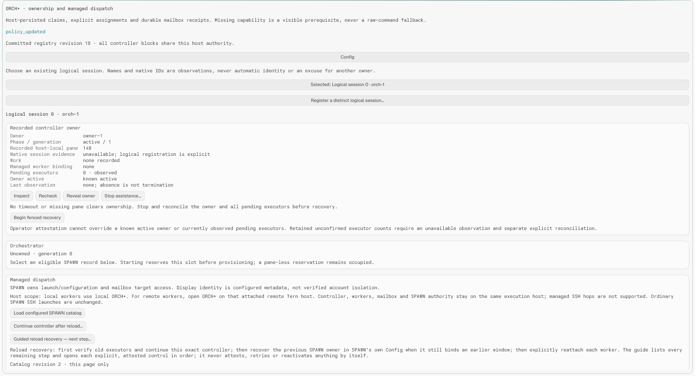
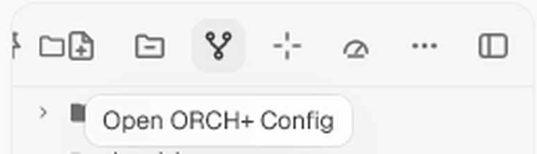
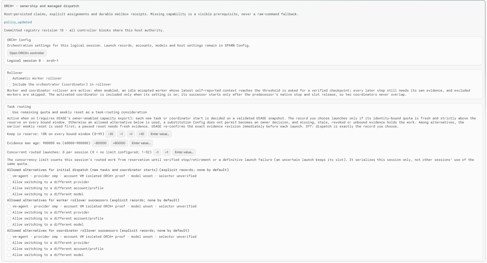

# ORCH+ for Tern

Run a team of AI agents from one controller in [Tern](https://docs.stencil.so/tern/): start a coordinator, hand out tasks or import a plan, watch health, have each change reviewed by a separate agent, roll tired agents over to fresh context and land their work one merge at a time. You decide what runs: each step needs your approval, or a session policy you set that approves chosen steps inside the plan's scope.

ORCH+ adds orchestration on top of native Tern and [SPAWN](../SPAWN/README.md). Tern gives you panes, sessions and native agents. SPAWN holds your roster of configured agent accounts and launches them. ORCH+ uses that roster to run managed workers:

- it assigns each worker an exact task;
- it reads the worker's structured reports through a private mailbox;
- it asks you whenever a decision is needed;
- it records every effect so that a launch, stop or message happens at most once, even across reloads.

Optionally, [USAGE](../USAGE/README.md) 2.1.0 or later supplies remaining-quota evidence, so new work goes to an account with capacity left and each worker's card shows how much of its account it used (see [Quota routing via USAGE](#quota-routing-via-usage)). Without USAGE, ORCH+ works fully and routing stays off.



## What it does

- **One controller per logical session.** One ORCH+ view claims the controller for a logical session. Other views of the same session show the same facts read-only and can reveal the controller.
- **Dispatch through SPAWN.** You pick a configured SPAWN record from a revision-pinned catalog and type the assignment, or start work from a plan file, a Tern board or an inbox folder. ORCH+ never sees commands, SSH settings or credentials and has no raw-command fallback.
- **Roles.** Every worker has a role that ORCH+ sets: builder, reviewer, release manager, labeller or coordinator. Builders build; a separate reviewer judges each change; only the release manager merges and deploys.
- **Structured reports, not screen scraping.** Workers report through a private report mailbox (READY, HEARTBEAT, ASK, CHECKPOINT, DONE and others). Check results and checkout facts come from SPAWN's helper, not from the worker's word. ORCH+ never reads transcripts or terminal output and never types into a pane.
- **Owner gates.** Questions, proposals, quota fallbacks, shared checkouts, out-of-scope changes, loop caps and landing approvals become durable gates. You answer them, or a session policy you chose answers in-scope proposals for you, visibly tagged as such.
- **Proof before landing.** A change lands only with a recorded proof: by default an approved review from a different provider family; with that switched off, passing helper-run checks plus an approved review.
- **Loop caps.** Anything that would engage a model again (re-requests, rework, refreshes, retries) stops at a cap you set and asks you.
- **Verified rollover.** A worker or coordinator close to its context limit hands over to a fresh successor through a checkpoint; no transcript is copied.
- **Landing queue and deploys.** Merges are queued per project, repository and target branch, with one granted slot per target. The release manager merges under the repository's own rules, then deploys where those rules define a deploy.
- **Reload recovery.** After a reload, ORCH+ guides you step by step back to a running controller. Uncertain effects are never replayed.
- **Quota routing and usage deltas (optional).** Fresh USAGE evidence decides whether your chosen record still has quota left and which allowed alternative to use otherwise, and shows per-worker account usage.

## Requirements

- Tern 0.9.10 or later.
- [SPAWN](../SPAWN/README.md) 0.4.0, installed on the same Tern host, with at least one record that declares the `report-files-v1` mailbox capability. A coordinator needs a record provisioned with `coordinator-control-v1`. Helper-run checks and checkout facts need `check-runner-v1` on builder records, and the release manager's record needs `release-manager-v1`.
- Optional, for quota routing and usage deltas: [USAGE](../USAGE/README.md) 2.1.0 or later, with its read-only capacity export enabled and each SPAWN account bound in USAGE Setup (**Bind SPAWN accounts…**; OMP records through **Associate OMP records…**).

## Install

Install SPAWN and ORCH+ on the Tern host that will run your agents. If you work from a desktop attached to a remote Tern host, also install both on the desktop so their window code (buttons, pickers, the Files button) loads there.

```sh
tern plugin link /path/to/SPAWN
tern plugin link "/path/to/ORCH+"
tern plugin reload orchplus --json
```

You can also use **Preferences › Plugins › Install…** and enter the ORCH+ directory, the one that contains `plugin.toml`. Tern reloads plugins whenever a linked directory changes, so edit a copy, not the linked directory, while agents are running.

Installing or reloading ORCH+ starts nothing. After installation you have two entry points:

- the **Open ORCH+ Config** button (`flow` icon) in the Files pane header, beside the SPAWN and WORK buttons. It opens the session's Config page;
- the **ORCH+** command in the command palette. It opens the controller.



Both entry points reveal an existing ORCH+ view in the current session rather than opening a second one. If ORCH+ cannot tell which view you mean, it shows a chooser.

When you upgrade from 0.3.0, stored settings, workers and landing items are migrated when the store is restored. A landing grant that 0.3.0 had already sent to a builder is never re-sent: it shows a `legacy_grant_outstanding` hold that you settle with **Result lost — hold slot…** or **Reconcile observed outcome…**.

### Update

Run **ORCH+ Check for updates** from the command palette. When a newer version is on GitHub, **ORCH+ Update** installs it in place: it checks the release's requirements and asks first, and can also update connected remote hosts. Tern then reloads all its plugins, and your settings carry over. If ORCH+ is running a controller, run **ORCH+ Reload recovery guide** afterwards.

A copy installed before the updater existed needs one manual update:

    tern plugin install --force github.com/blastworksai/tools/plugins/tern/ORCH+

A linked development checkout (`tern plugin link`) is never updated by the plugin; `git pull` it yourself.

## Use

All ORCH+ controls are native buttons, except the two reload recovery commands described in [Recover after a reload](#recover-after-a-reload), which you run from the command palette. Buttons that change something ask for confirmation, or open a picker or prompt, before they act. Once the controller has run its first command, a dispatch or assistance button runs only in the window that owns the controller; every other window showing the same controller ignores it. (Assistance on a controller restored after a host reload stays open to any window, so you can still inspect or stop its recorded owner.) A button from an outdated view is refused as stale and never replayed. If the host gets no confirmation from an ORCH+ window within 30 s, the press expires with a notice that it will not run later. A window may still have run it, so check the current state before pressing again.

### Claim the controller

1. Open ORCH+ from the palette.
2. On a brand-new installation, choose **Initialize first-use authority…** and confirm that there are no earlier owners and no lost store. ORCH+ never replaces missing data silently.
   First-use initialization is only for a truly fresh ORCH+ and SPAWN pair. If the ORCH+ store is lost, restore its backup, or reset SPAWN's plugin state together with ORCH+'s. Never re-initialize ORCH+ alone while SPAWN keeps its `dispatch-v1` state: ORCH+ request and logical session ids restart from the beginning, collide with fences SPAWN still retains, and SPAWN refuses the new requests with `content_conflict` ("Compacted request ID reused").
3. Select your logical session. If this really is separate work, choose **Register a distinct logical session…** instead.
4. Choose **Claim controller in this pane**. Only this view can now dispatch; every other view shows the same owner as occupied.

Closing the controller pane does not release ownership. Reopen ORCH+, select the same session and use **Recheck**. To move ownership to a new pane, follow the recovery steps shown on the owner card. Each step asks you to confirm that the old owner and its executors have stopped.

### Config page

Every ORCH+ view has a **Config** button, and the Files-header button opens Config directly. **Open ORCH+ controller** takes you back. Only the active controller can edit settings. Other views show them read-only, with the reason.

Checkboxes and −/+ buttons edit a draft. **Save session settings** commits only the fields you changed, and is refused if the saved settings changed in the meantime (another save, or pause/resume). **Enter value…** and **Enter time…** accept a single bounded value. Lists, records, paths, templates and role guidance save one entry at a time.



| Card | Setting | Default | Range |
| --- | --- | --- | --- |
| Rollover | Automatic worker rollover | off | on/off |
| | Roll over at x% of worker-reported context | 80 | 1–99 |
| | Include the orchestrator (coordinator) in rollover | off | on/off |
| Task routing | Use remaining quota and weekly reset in task routing | off | on/off |
| | Keep in reserve (%) | 10 | 0–99 |
| | Evidence max age | 15 min | 1–15 min |
| | Allowed alternatives: initial dispatch / worker rollover / coordinator rollover | none | up to 24 records each |
| | Allow a different provider / account / model, per kind | off | on/off each |
| | Concurrent routed launches per session | 0 (no limit) | 0–32 |
| Scheduling | Automatic progress-report requests | off | on/off |
| | Poll interval | 5 s | 1–60 s |
| | Heartbeat | 60 s | 5 s–1 h |
| | Stale after | 3 min | heartbeat–24 h |
| Mailbox sweep | Nightly orphan mailbox sweep | on | on/off |
| | Sweep time | 03:00 | local 24-hour time |
| Loops | Loop cap | 3 | 1–10 attempts per loop |
| | Review rounds | 2 | 1–2 per piece of work |
| | Stale-claim alert after | 30 min | 0 (off)–1440 min |
| Review & proof | Enforce cross-family review | on | on/off |
| | Family map | empty | up to 24 records |
| | Reviewer records (tried in order) | none | up to 8 |
| Release | Release manager record | none | one record |
| Checkouts | Checkout roots | none | up to 8 absolute paths |
| Autonomy | Approve in-scope proposals by policy: dispatch / report / review / landing | none | any subset |
| Work sources | Glitch integration (offer `/glitch-plan` files) | on | on/off |
| | Default work source | `/glitch-plan` file | plan file or Tern board |
| | Board path; lane titles (queued, running, review, done) | none; Todo, Doing, Review, Done | absolute path; ≤64 characters each |
| | Inbox folder | none | absolute path |
| | Launch new board cards and inbox files automatically | off | on/off |
| Routing | Routes (work class → record) | none | up to 16 |
| | Labeller record | none | one record |
| Role guidance | Builder, reviewer, release manager, labeller, coordinator | empty | ≤1024 characters each |
| Templates | Template chain steps | none | up to 16 |

The whole saved policy is limited to 48 KiB ("Settings too large — shorten templates or guidance").

The **Pane orchestration list** shows every agent pane in the current session, ticked by default. Unticking a managed worker excludes it from automatic report requests and automatic rollover. Unticking never stops or retires anything. **Pause new work** / **Resume scheduling** holds or releases new work without blocking settlement.

Launch records, accounts, models and host settings stay in **SPAWN Config**. ORCH+ Config cannot set commands or credentials.

### Assign tasks and start a coordinator

1. In the controller, choose **Load configured SPAWN catalog**. You see the configured records with their capabilities, plus the reason any record is unavailable. Use **Next catalog page** when there are more.
2. Choose **Assign explicit task to …** for an ordinary (builder) worker, or **Start selected coordinator …** for the session's coordinator, then type the assignment.
3. SPAWN provisions the worker's report mailbox and launches the configured record in its configured directory and placement. The worker accepts the exact assignment and starts reporting.

Each worker's health card shows its role, declared family, native state, last report, context use (as reported by the worker), review and proof status, usage delta and pending gates. **Queue immutable progress request** asks a worker for a report now, and **Open exact relevant pane** reveals it. Workers follow [worker-brief.md](worker-brief.md); coordinators additionally follow [coordinator-brief.md](coordinator-brief.md).

A coordinator only proposes. Each proposal becomes a gate that you answer with **Answer exact question…**, unless your session policy answers it (see [Autonomy inside plan scope](#autonomy-inside-plan-scope)). A coordinator can never launch agents, review, merge code or change accounts itself.

When work is done, **Finish ordinary worker…** stops the worker's exact pane and then retires its mailbox. A DONE report alone never stops anything. Reviewers and labellers finish automatically once their one answer is settled. A coordinator finishes through **Request graceful coordinator retirement** or its own release.

### Roles

ORCH+ sets each worker's role; a worker never chooses it.

- **Builder:** any task you assign or that comes from a plan, the board, the inbox or a template. It builds, runs its declared checks through SPAWN's helper, asks for review and requests landing. It never reviews its own work and never merges.
- **Reviewer:** a fresh short-lived worker per review round, launched by ORCH+ on the first suitable record in **Reviewer records**. It answers one fixed question — does the change implement the task as specified, without changes outside its scope — with `approved` or `changes_required` and findings tied to file and line. No scores.
- **Release manager:** the session's only merging actor, launched on **Release manager record** (which needs `release-manager-v1` and must differ from the builder's and the reviewer's records). It merges exactly the granted revision following the repository's own rules, then deploys where those rules define a deploy.
- **Labeller:** a short-lived worker on **Labeller record** that picks a work class for intake without one (see [Work-class router](#work-class-router)).
- **Coordinator:** proposes work, reports, reviews and landings; you or your policy decide.

**Role guidance** in Config is prepended to every assignment ORCH+ sends for that role — typed tasks, coordinator starts, attached panes, approved dispatch proposals, and the reviewer, release-manager, labeller, plan, board, inbox and template assignments. It is guidance, not enforcement. To actually restrict what an agent can do, restrict its tools in the CLI flags of its SPAWN record.

Reviewers, the release manager and the labeller run on the records you chose for them; they are never quota-routed. The **Release manager record** picker lists only records offering `release-manager-v1` that are not reviewer records, and the reviewer picker leaves out the configured release manager.

### Scope, checks and shared checkouts

Work can declare its files, scope (paths and outside systems) and checks. Plan tasks declare them from the plan; ORCH+ passes them to SPAWN as an authenticated manifest. On a record with `check-runner-v1` the builder runs SPAWN's helper:

- `checkout` reports the worktree, branch, head and changed files straight from git;
- `run-checks <check_id>` runs that declared check's exact command from the manifest (never a command the worker supplies) and reports its exit code on the current head.

ORCH+ opens a gate when:

- two same-session workers would share one checkout under a configured **checkout root** (`shared_checkout`; other sessions' workers are not visible);
- declared files overlap another live worker's files (`file_overlap`);
- a checkout changes files outside the declared scope (`scope`).

ORCH+ cannot see the outside systems a task lists: workers and coordinators must ASK before touching any system not listed there.

### Review and the proof rule

When a builder reports REVIEW_READY, ORCH+ opens a review and launches a reviewer. With **Enforce cross-family review** on (the default), the reviewer must be on a record whose declared provider family differs from the builder's. `changes_required` sends the builder one `rework` reply with only the findings (and, with enforcement off, the checks that failed); the builder fixes those, publishes a new revision and asks for review again. **Review rounds** caps the rounds, then the owner decides. A new revision voids any earlier approval.

Landing needs proof for the exact revision:

| Enforce cross-family review | Proof |
| --- | --- |
| on | an approved review from a reviewer of a different declared family (helper checks are kept as evidence) |
| off | every declared check passed through SPAWN's helper on that revision, and an approved review by a reviewer other than the builder (same family allowed) |

Families come from the **Family map**, or else from the provider (Claude → anthropic, Codex → openai, Kimi → moonshot, Agy → google, Grok → xai, Muse → muse). OMP and unknown providers have no family until you map them.

### Loop caps and stale claims

Every loop that would re-engage a model or a worker — a rollover checkpoint request, a progress report request, an owner retry after backpressure, a landing refresh, a check rework, a review round, a deploy retry, a labeller retry, a template chain — stops at **Loop cap** with one `loop_cap` gate naming the loop. **Allow more** resets only that loop; **Keep it stopped** is final. Waits that cost no model call (quota re-evaluation, transport backoff, read-backs) stay time-bounded instead.

An effect claimed for longer than **Stale-claim alert after** raises one `stale_claim` gate. ORCH+ never takes over a claim; the gate points you to the recovery guide.

### Autonomy inside plan scope

Approved proposals do something. Whether you approved them or your session policy did, ORCH+ carries each one out exactly once: `dispatch` queues the proposed record and prompt as new work that inherits only the parent's source and scope; `report` asks the worker for a report; `review` opens a review by a separate reviewer worker; `landing` approves the matching landing request.

A proposal is **in scope** when its work:

- came from an imported plan or the board (`source.kind` `plan` or `board`);
- has declared `scope.paths`;
- has no open `scope`, `file_overlap` or `shared_checkout` gate;
- and, for `dispatch`, names a record that is current and eligible.

In Config, **Autonomy** picks which in-scope kinds (`dispatch`, `report`, `review`, `landing`) the policy answers for you. None are picked by default. Choose `landing` with care: a policy approval of a landing is a real approval, and the work merges once the rest of the landing proof holds. Out-of-scope proposals always wait for you: the proposal gate itself says why the work is outside plan scope, and if you approve it, it is carried out just like an in-scope one.

Every policy answer is recorded with its source, policy revision and rule, and shows on the gate as a policy answer, not yours. Policy never bypasses loop caps, check and review proof, capacity limits or pause, and never approves a landing while the session is paused.

A proposal sent while the session is paused is refused (`session_paused`), and so is a proposal naming work without a retained CHECKPOINT of its project (`scope_mismatch`). ORCH+ answers its gate `reject` itself (shown as refused by ORCH+, not as your answer) and tells the coordinator once; the coordinator's reports keep flowing and it may propose again, even with the same proposal id. Pause answers nothing by policy; on resume, each still-pending in-scope proposal is evaluated once against the current Autonomy settings.

### Work sources

**Start work…** in the controller offers:

- **From a /glitch-plan file.** The execution host reads and imports the plan. Checkpoints run in order: the next starts only when every task of the current one has landed or finished. Tasks marked INDEPENDENT start together, up to the concurrency limit; sequential tasks wait for earlier ones. Each task runs on the route for its class (or the `build` route) and carries the plan's files, scope and checks. Re-importing a changed plan supersedes the old import without restarting work that is already running. Turn **Glitch integration** off to hide this option.
- **From a Tern board.** Cards in the board's queued lane become work; ORCH+ moves each card through the running, review and done lanes as its work progresses. A card tag `class-<route class>` (for example `class-build`, optionally `#`-prefixed) picks the route; other tags never route.
- **From a template** (listed only when templates are saved). Pick a template and enter its `{input}`. Each Config → Templates row also has a **Start…** button.

Each imported plan has a controller card, **Imported plan · <title>**, with the plan id, short revision, status and path, then each checkpoint (number, title, task count, flags) and each task (id, title, state, independent, worker, hold, flags), eight rows per page.

An **inbox folder** works the same way for files: each new file becomes work (a `**CLASS**: <slug>` line picks the route), and the file is archived once its work launches. Intake is durable and deduplicated, so two windows never create the same work twice. With **Launch new board cards and inbox files automatically** off, each new item waits for your intake decision.

**Templates** define chains of steps: each step's prompt takes one `{input}`, and the output file named in its DONE report becomes the next step's input. A chain stops after eight steps.

### Work-class router

**Routes** map a work class to a SPAWN record. Work that arrives without a class is labelled by a short-lived labeller worker, which picks one of your route classes; ORCH+ then routes the work in code. The model and effort are whatever that SPAWN record runs; ORCH+ never sets CLI flags. A class with no route opens a `label_unknown` gate (**Route it**, **Label again** or **Cancel**). With no labeller record, the intake waits as `label_pending`.

### Worker rollover

**Roll over worker…** on a worker's health card, or automatic rollover at the Config threshold, works in four steps:

1. ORCH+ asks the worker for a CHECKPOINT that lists completed and remaining work and includes fresh check results.
2. It starts a fresh successor from the same SPAWN record (or an allowed alternative when quota routing is on), with the checkpoint as its assignment and the same role, files, scope and checks.
3. It waits until the successor accepts the exact handover and is observed running.
4. Only then does it stop the predecessor.

The predecessor keeps running until the successor is accepted. A failed step holds with a reason. You can cancel with **Cancel rollover…**, and nothing is retried blindly.

### Coordinator rollover

With **Include the orchestrator (coordinator) in rollover** on, or through **Roll over coordinator…**, the coordinator hands over in the same way. Two coordinators never run at the same time:

1. The coordinator checkpoints and is retired.
2. Its exact pane stops and its mailbox is retired.
3. Only then is the successor started, carrying the handover.

If the stop is uncertain, the handover waits for the owner recovery steps.

If the successor fails to start or to accept the handover, no coordinator is active, because the predecessor is already retired. The hold says so and shows SPAWN's reason. To continue, stop the successor pane, then run fenced recovery on the successor's orchestrator owner card. That closes the rollover, and you can start a new coordinator from the retained checkpoint.

### Landing queue

A builder that wants to merge sends a landing request for an exact checkpointed commit and target branch. Each request opens a **landing approval** gate. Only the head of the target's queue can be granted, and only when:

- the request is approved (by you, or by your landing auto-approval policy for in-scope work);
- the proof rule holds for that exact revision (see [Review and the proof rule](#review-and-the-proof-rule));
- a release manager is configured on a record that is neither the builder's nor the reviewer's;
- the builder's latest checkpoint for that commit has fresh passing checks and no holds, and its checkout matches and is in scope;
- the target head is the one the request expected.

The builder never merges. ORCH+ sends the grant to the session's release manager, which performs the approved merge under the repository's own rules and reports the result. ORCH+ never runs git.

If the target moved before the grant, the item is blocked as `target_moved`. If the release manager finds the target moved (`stale_target`), the slot is freed and the item stays in place needing refresh. Either way ORCH+ sends the builder exactly one `landing_refresh` notice with the expected and current heads; the builder rebuilds, gets a fresh review and sends a fresh request, which needs a new approval. Refresh cycles count against the loop cap.

After a merge lands, ORCH+ sends the release manager one deploy grant for that revision. The release manager deploys where the repository's rules define a deploy, or reports that none applies. A deploy the rules mark as needing a decision (`held`), or a failed one, opens a `deploy_hold` gate: you allow it, retry it (a new attempt, capped by the loop cap) or stop it.

Use **Move up**/**Move down** and **Cancel…** on ungranted items. While an item needs a refresh, its row reads "approval void — awaiting fresh review/request" instead of "owner approved". When a granted result is lost, use **Result lost — hold slot…** (or **Deploy result lost — hold…**) and later **Reconcile observed outcome…**. Nothing is re-granted automatically.

### Adopt a hand-opened agent pane

On the Config page, an idle, ticked agent pane that you opened yourself offers **Attach pane N as ORCH+ worker…** once a catalog is loaded. Pick a matching `native-agent` SPAWN record and type the assignment. You also confirm that you checked this exact pane. ORCH+ re-checks the pane just before acting. From then on it is an ordinary managed worker.

Nothing is adopted automatically, and shell panes are never typed into. Coordinators cannot be adopted.

### Recover after a reload

After a plugin or host reload, the controller becomes uncertain and nothing new runs. In the window you are working in, run **ORCH+ Reload recovery guide** from the command palette. The same list appears in the controller as the **Reload recovery checklist**, and it walks you through:

1. continuing the controller in this window, after you confirm the old executors stopped. You can also run **ORCH+ Continue controller in this window** from the palette directly;
2. recovering the previous SPAWN owner in **SPAWN: Running agents**;
3. **Continue after reload / reattach explicitly…** for each worker, with its recorded pane.

Use the palette commands, not the **Continue controller after reload…** and **Guided reload recovery — next step…** buttons, after a reload. A button press does not tell ORCH+ which window it came from. When two windows show the same session (for example a desktop window attached to a remote host and a window on that host), a press could otherwise open the picker in the other window and make that window the controller's origin. The buttons therefore only work in the window that already owns the controller. A palette command always runs in the window you typed it in. If several controllers are open in the session, focus the one to recover first.

ORCH+ reads uncertain effects back from SPAWN automatically, with read-only status reads only. **Read retained SPAWN outcome (never relaunch)** does the same read on demand.

Work that was queued but had not launched yet moves to the continued window. Its launch then runs there, even when its mailbox provision finished only after you continued. A launch that had already started in the old window is never re-run; it stays uncertain until its outcome is read back.

Some never-launched work cannot move: SPAWN already received its launch or provision (for example a launch whose window authorization expired and was rechecked), or it is an adoption whose ask was never sent. Continuation marks that request as never executed, and the worker shows **Cancel never-launched work…**. If SPAWN received the request, ORCH+ first reads SPAWN's retained status of it and cancels only when that request can never run: SPAWN has no record of it, rejected it, or reports that it was refused before any effect (an expired challenge counts). While SPAWN still holds a live challenge, wait 30 seconds and try again. Without a mailbox, cancelling removes the worker and frees its reservations at once. If its mailbox was already provisioned, cancelling retires that never-used mailbox through the exact retirement path and keeps the worker visible until SPAWN confirms retirement; the worker is then removed and its reservations, including a coordinator start's slot, are freed. If SPAWN refuses the retirement, cancel again to issue one fresh retirement; a pending or uncertain one is never repeated. Nothing is stopped or re-sent. Then queue the assignment again; it gets a new launch request.

### Quota routing via USAGE

> **Needs USAGE 2.1.0 or later.** Quota routing reads USAGE's read-only `usage.capacity` block and needs an owner-confirmed binding between each SPAWN account and its USAGE reading (USAGE Setup: enable capacity export, **Bind SPAWN accounts…**, and **Associate OMP records…** for OMP records). With routing on and no bound evidence, ORCH+ holds the task and says why ("no allowed record has sufficient fresh quota"). It never guesses. Routing is off by default.

Turn on **Use remaining quota and weekly reset in task routing** and enable USAGE's read-only capacity export (ORCH+ opens USAGE's capacity block in the background **SPAWN bridges** tab and reuses it after reloads). For each new task or coordinator start — typed, from a plan, the board, the inbox, or an approved proposal — the record you chose launches unchanged as long as its fresh, identity-bound USAGE evidence shows more remaining quota than the reserve. Otherwise ORCH+ picks the allowed alternative with the earliest weekly reset, but only if its provider, account and model changes are permitted in Config. If no permitted alternative qualifies, ORCH+ opens a quota-fallback gate for you to decide.

Missing, stale or unbound evidence never counts as "plenty". An OMP record uses its account's quota only after you associate it with that account in USAGE Setup (**Associate OMP records…**); until then it is unbound. USAGE confirms the evidence again right before each launch. **Refresh quota evidence from USAGE** and **Re-check capacity now** fetch fresh evidence. Rollover successors use their own allowlists.

**Usage deltas.** Each worker records its account's USAGE reading when it launches and when it reports DONE (refreshed at finish). Its health card shows the change per quota window, or why the two readings are not comparable (no bound reading, a different account, or a reset in between), and how many other workers shared that account during the run.

## Where ORCH+ runs

ORCH+ orchestrates on the Tern host it runs on. The controller, the coordinator, the workers, their mailboxes and SPAWN's records all live on that one host:

- **Local agents:** open ORCH+ in a local Tern window.
- **Agents on a remote host:** attach a Tern window to that remote Tern host and open ORCH+ there. That host's ORCH+ and SPAWN run the work, and the desktop only displays it.

ORCH+ never reaches across an SSH hop. SPAWN records that launch through SSH are not eligible for managed dispatch, although ordinary SPAWN SSH launches keep working. There is no federation between hosts and no automatic migration.

## Safety guarantees and limits

- **Exactly-once effects.** Every launch, mailbox operation, message, wake and stop is recorded with an exclusive claim before it runs. After a lost or ambiguous result, ORCH+ only reads status back. It never resends or relaunches.
- **Fail closed.** Reloads, storage failures, capacity limits and missing panes keep ownership and work occupied until you verify and recover them explicitly. A timeout or missing pane never counts as "stopped".
- **No transcripts.** ORCH+ never reads a pane's transcript or screen and never types into terminals. Workers communicate only through structured reports, and you communicate with them through immutable replies.
- **No SSH hop.** See [Where ORCH+ runs](#where-orch-runs).
- **Your decisions are explicit.** Approvals, attestations and recovery steps are buttons you press, or policy answers you configured, which are tagged as policy. ORCH+ labels operator attestations as such, and never invents approval or infers a merge from DONE or an idle pane.

Known limits:

- **Same-user trust.** Tern's UI events do not authenticate a person: any process running as your OS user could press the same buttons. Helper-produced check results and checkout facts are produced by code, not by the worker's word, but they are not tamper-proof against a worker that edits the helper or its files; the same limit applies to all report intake.
- **Families are declared, not verified.** ORCH+ cannot see which model a record actually runs. Cross-family review is only as good as your family map and provider settings. Model and profile selectors are shown as unverified, because SPAWN provides owner-entered text only.
- **The board is desktop-only.** Tern's board API exists only in the desktop window, and neither boards nor folders send change events, so the board and inbox are polled. When the window is attached to a remote host, the board path is on the desktop and is used only after you confirm it once; the inbox folder is polled only when the window runs on the execution host.
- **Usage deltas are account-level.** USAGE reports a remaining percentage per account window only, so a delta covers everything that used the account in that time, not one worker's exact use.
- **Idle windows.** Tern does not wake an untouched window when one of its timers comes due. While an ORCH+ window drives an active controller with timed work, an idle-wake helper keeps one short `sleep 2` child (`ping` on Windows) running so the window keeps observing and dispatching; the Health card shows **Idle-wake helper active: …** or **Idle-wake helper unavailable: …**. Inbox or board polling this window performs counts as timed work, so a controller with only an intake inbox or board configured keeps the helper running (Health: **Idle-wake helper active: polling the intake inbox** / **the board** / **the intake inbox and board**). A remote host's inbox, or an unconfirmed remote board, does not. A window without an active ORCH+ controller (for example one showing only SPAWN) gets no helper and can still stall until it is used, as can a controller awaiting continuation.
- Effects are driven by an attached ORCH+ window. With no window attached, nothing new starts, and the nightly sweep catches up on the next attach.
- A confirmed native pane stop does not prove that every remote child process exited.
- Landing, reviewers, the release manager and the labeller do not use quota routing. Reserves cannot be set per quota window.
- Durability is that of Tern's plugin key-value store. One Tern host process per data directory is assumed.

The full protocol is documented in [REFERENCE.md](REFERENCE.md): storage limits, roles, proof, mailbox and sweep rules, dispatch and recovery details, and the rollover, landing and deploy state machines.

## Verification

The tests run inside Tern's Lua runtime against a disposable data directory, together with a disposable SPAWN package. The entrypoint `tests/run.luau` takes the plugin directory and one or more `group[/section]` selections:

```lua
local root = "/path/to/ORCH+"
return assert(loadstring(tern.fs.read(root .. "/tests/run.luau")))(root, "dispatch/rejected_read")
```

| Group | Covers |
| --- | --- |
| `state` | authority registry, admission, persistence and capacity reserves |
| `transport` | report-files-v1 codecs, closed reply schemas, landing proof and signer rules, hashing |
| `authority` | host block: duplicate views, stale buttons, store changes, restore |
| `dispatch` | dispatch reducer: claims, results, quota routing, rollover, retirement, sweep, Config policy and loop caps |
| `reports` | report intake, context usage, checkout gates, check proof, landing queue and refresh notices, 0.3.0 landing upgrade |
| `gates` | owner gates, answers and cancellation, stale claims, policy answers |
| `health` | window scheduler, health, reload recovery, bridge panes, Config views, work picker, inbox, usage row, template start, role pickers, landing row, imported plans, idle-wake helper, gate refusals, Finish refusals (`template_start`, `role_pickers`, `landing_row`, `plans_view`, `idle_wake`, `gate_refusal`, `finish_refusal`) |
| `workflow` | plan import, reviews and rounds, proof rule, release manager, deploys, landing grid, autonomy, work sources, router, usage deltas |

Run each group in its own callback; long sections can also run one at a time (the `gates` group is run per section). SPAWN has its own suites. See its [README](../SPAWN/README.md#tests). [REFERENCE.md](REFERENCE.md#test-sections) lists the named sections.

## Files

- `plugin.toml`: package manifest and the `orchestrator` block
- `window.luau`: palette commands (open, continue controller, recovery guide), Files button, button routing, scheduling, SPAWN and USAGE bridges, board and inbox polling
- `host.luau`: controller and Config block, and the only writer of ORCH+ state
- `views.luau`: controller and Config rendering
- `state.luau`: ownership registry and persistence rules
- `dispatch.luau`: dispatch, report, gate, review, rollover, landing, deploy, work-source and sweep reducer
- `transport.luau`: report-files-v1 codecs and the landing proof rule
- `quota.luau`: USAGE capacity normalization, routing rule and usage deltas
- `plan_import.luau`: `/glitch-plan` file parser
- `worker-brief.md`, `coordinator-brief.md`: contracts for managed agents
- `REFERENCE.md`: full protocol reference
- `CHANGELOG.md`: release notes
- `requires.json`: minimum Tern and SPAWN versions checked by **ORCH+ Update**
- `updater/`: vendored self-updater (from `shared/tern-updater`; do not edit here)
- `mockups/`: conceptual SVG mockups
- `assets/screenshots/`: the screenshots in this README
- `tests/`: native regression suites

API references: [host lifecycle and block views](https://docs.stencil.so/tern/reference/api-host.html), [native UI nodes and actions](https://docs.stencil.so/tern/reference/ui.html), [window APIs](https://docs.stencil.so/tern/reference/api-window.html).

## License

MIT. See the repository [LICENSE](../../../LICENSE).
