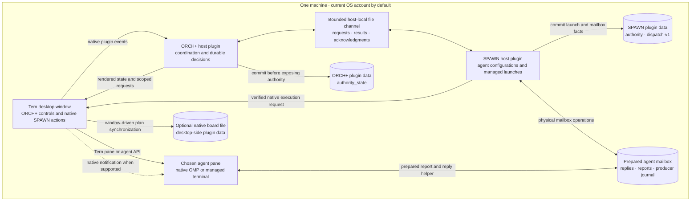
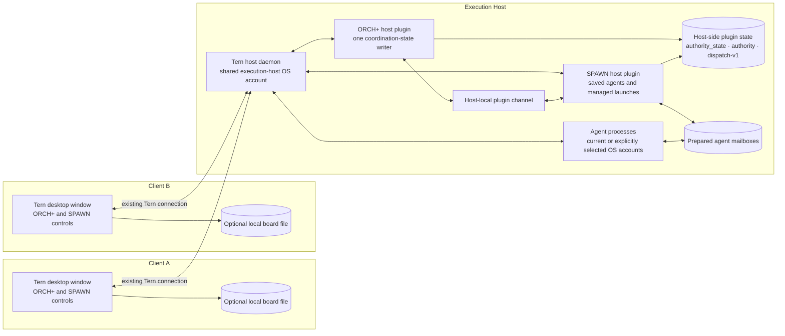

# ORCH+ — runtime and state boundaries

Architecture review of the current source. It is a read-only review: no installation, reset, login or launch was performed for this document.

The intended model is **one Linux execution host and two clients** (for example one Windows and one Mac desktop) that share it. The two clients are not execution hosts.

## One device — the default

The host plugins and window half are different runtimes, not separate product services. There is no parked transport pane or extra ORCH+ background daemon. Files in the plugin channel carry messages; they do not grant authority by themselves.

| State | Owning writer | What it records |
|---|---|---|
| `authority_state` | ORCH+ host | Controllers and generations, projects, plans, approvals, START snapshots, claims and action outcomes. |
| `authority` | SPAWN host | Saved agent/account configuration and reviewed launch settings. |
| `dispatch-v1` | SPAWN host | Managed requests, worker bindings, native authorizations and mailbox generations. |
| Agent mailbox and producer journal | Prepared helper and SPAWN's mailbox operations | Actual published replies, reports, local claims, receipts and replay/settlement evidence. |
| Native board file | Tern window | A synchronized work view. Changing a card does not itself authorize an agent launch. |

The ordinary route uses the current OS account. Explicit per-agent Unix accounts are an advanced SPAWN choice; they change process and helper-resource ownership, not the owner of the ORCH+ host runtime. Account labels are not security isolation. Setup checks do not establish provider login or real-task readiness.

## Three devices — two clients and one execution host

Client A and Client B are desktops, for example Windows and macOS. The Execution Host is one Linux machine. Both clients connect to the same execution host. The shared-state model below assumes the same execution-host OS account and Tern host daemon; a different host account has separate plugin data.

There is one execution host and shared host-side state, not two independent ORCH+ installations coordinating across hosts. A client-to-host connection is not an extra SSH hop for agents already running on that host. Standalone SPAWN SSH-command records are a separate launch mode.

Two clients do not automatically become simultaneous controllers of the same orchestration. Its admitted controller remains bound to an exact owner, generation, source pane and window route. Opening another client is not permission to take that control or repeat an earlier launch.

Agent processes, execution folders, durable coordination state and mailboxes stay on the execution host. Native board files remain client-side; this diagram does not claim automatic replication of a board file between clients. A desktop-side file is not necessarily in the operating system's Desktop folder. Closing the controlling window does not automatically transfer its role to the other client or promise unattended scheduling.

## Authority and message ordering

For project START, ORCH+ first saves a grant for an exact coordinator owner/generation, project revision and captured work membership. SPAWN and the prepared helper publish and deliver the immutable reply. Publication alone does not release tasks. The coordinator must consume the reply and publish its exact `PROJECT_START_CLAIM`; the accepted claim is what permits ORCH+ to release that captured work.

After reload, saved identity and outstanding effects are retained. Observing an earlier result is different from repeating its action. Unknown outcomes remain held; a missing pane or timeout is not proof that an agent stopped.

## Evidence and limits

The completed isolated Linux journey used actual Tern controls, physical shipped helpers and deterministic terminal actors. It observed START publication, claim, one physical child launch, background settlement without a focus/session change and continuation through two reloads without duplication. It did not qualify real provider accounts, native OMP or this three-device example. The final captured UI still showed a neutral reconnect notice after both workers attached.

Source files: [ORCH+ README](https://github.com/blastworksai/tools/blob/main/plugins/tern/ORCH+/README.md), [SPAWN README](https://github.com/blastworksai/tools/blob/main/plugins/tern/SPAWN/README.md), [ORCH+ plugin.toml](https://github.com/blastworksai/tools/blob/main/plugins/tern/ORCH+/plugin.toml), [SPAWN plugin.toml](https://github.com/blastworksai/tools/blob/main/plugins/tern/SPAWN/plugin.toml), [ORCH+ host.luau](https://github.com/blastworksai/tools/blob/main/plugins/tern/ORCH+/host.luau), [SPAWN dispatch.luau](https://github.com/blastworksai/tools/blob/main/plugins/tern/SPAWN/dispatch.luau) and [SPAWN authority.luau](https://github.com/blastworksai/tools/blob/main/plugins/tern/SPAWN/authority.luau). The separate code-linked walks resolve each action's precise lines and observed output; see the [documentation index](README.md).
