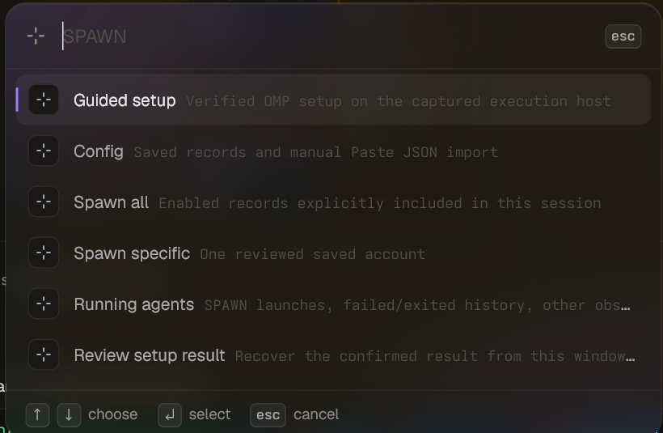
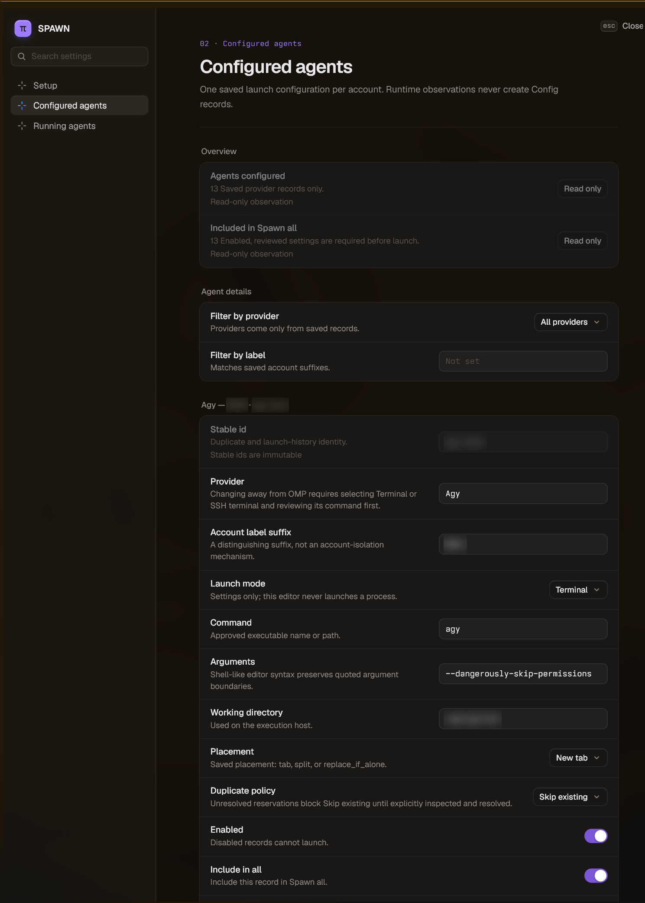

# SPAWN for Tern

Define your agent roster once, then start all of it, or one account, with a single action in [Tern](https://docs.stencil.so/tern/).

SPAWN keeps one saved launch record per provider account (Claude, Codex, Kimi, Muse, Agy, Grok, OMP or anything else with a command line). **Spawn all** opens every included account in the current Tern session, each in its own named, coloured tab with its provider's icon. SPAWN then tracks each launch and shows what happened to it: running, waiting for input, exited or failed.


*After **Spawn all**: one tab per account, named `ProviderSuffix`, coloured per provider. Account suffixes are blurred.*

[USAGE](../USAGE/README.md) and [ORCH+](../ORCH+/README.md) build on SPAWN's roster.

## What it does

- **One record per account.** Provider, account suffix (`Work`, `Personal`, …), command, arguments, working directory and placement. Optionally an OS user, an SSH destination and, for OMP, a startup prompt.
- **Spawn all / Spawn specific.** Spawn all starts every enabled record you included, one after another, 5 seconds apart. Spawn specific starts one account.
- **No accidental duplicates.** With the default duplicate policy (`skip`), an account that is already running, or whose last launch is still unresolved, is skipped rather than started twice. `allow` is an explicit per-record choice.
- **Honest outcomes.** Every launch is reported as `Starting`, `Running`, `Waiting for input`, `Exited`, `Failed` or `Unknown`. A closed pane is never counted as a successful exit. `Unknown` stays visible until you resolve it.
- **Output is kept.** Terminal launches run inside an ordinary shell, so a failing command leaves its error and exit status on screen.
- **Native OMP.** OMP records start as genuine native Tern OMP sessions with their saved startup prompt, which is delivered once per launch and never resent on reload.
- **Tabs you can tell apart.** Tabs are named `ProviderSuffix` (for example `CodexWork`), coloured per provider, and show the provider's icon on local and remote hosts.
- **Guided setup.** An OMP-driven conversation asks which providers and how many accounts you have, discovers each command on the execution host, and produces a roster you review before import. You can also add records by hand or paste JSON.
- **Plain `+` is untouched.** Tern's normal new-tab button keeps working as before. Loading SPAWN never starts anything by itself.

## Requirements

- Tern 0.9.10 or later.
- The provider CLIs you want to run, already installed and signed in on the machine where the agents will run (the *execution host*).
- Native OMP launches need a POSIX shell (`sh`, `bash`, `dash`, `ksh`, `zsh`) on the execution host. Terminal launches also work under PowerShell (`pwsh`/`powershell`).

## Install

Install SPAWN on the Tern host that will run your agents. If you work from a desktop connected to a remote host, also install it on the desktop so its window half (menus, tab icons) loads there.

```sh
tern plugin link /path/to/SPAWN
tern plugin reload spawn --json
```

Tern reloads plugins whenever a linked package directory changes. Edit a copy, not the linked directory, while agents are running.

## Use

Open SPAWN from the command palette (**SPAWN**, **SPAWN: Config**, **SPAWN: Guided setup**, **SPAWN: Running agents**) or from the SPAWN button in the Files pane header.




1. **Set up the roster.** Run **Guided setup**, or open **Config** and add records on the Setup page. Every command and argument is shown for review before anything is saved; importing never launches anything.
2. **Choose what Spawn all includes.** On **Configured agents**, mark records as enabled and included.
3. **Spawn.** Pick **Spawn all** or **Spawn specific** from the SPAWN menu. Launches go into the Tern session you are in when you start the batch, and changing focus mid-batch cannot redirect them. Spawn all waits 5 seconds after each launch reaches the host before starting the next, so agent start-up memory spikes don't stack. Skipped, duplicate and disabled records don't wait, and the first launch (including Spawn specific) starts at once.
4. **Watch.** **Running agents** lists this session's SPAWN launches, failed and exited history, and other Tern sessions (read-only). When a batch finishes cleanly, SPAWN hides its Config view; Config and the SPAWN menu bring it back.
5. **Resolve.** If a launch ends up `Unknown`, inspect its pane first, then choose **Mark no longer running**. That releases the reservation only; it never closes or kills anything.
6. **After a host restart.** If the execution host's Tern daemon restarted, SPAWN shows one notice ("Host restarted — N SPAWN agents were lost") instead of N separate problems. After checking, choose **Running agents → Host restart → Mark all lost agents no longer running** (or the same action on Config's Running agents page, which asks you to click twice). It releases exactly those reservations so the accounts can be spawned again; it never closes a pane or stops a program.

If a window request was interrupted (for example by a host restart) and the host's saved reply is a refusal, nothing ran, so SPAWN acknowledges it for you with an info toast and carries on with your next request. Any other interrupted request still waits for you under **Running agents → Transport review**; acknowledge it there, then try again.

### Launch modes

| Mode | Use it for | How it runs |
| --- | --- | --- |
| **Terminal** | Most CLIs | Opens a normal shell pane on the execution host and types the approved command into it once. The shell stays after the command ends. |
| **SSH terminal** | An account on another machine | Runs `ssh` from that shell with the saved destination, user and key path, then the command on the other side. The remote command is quoted for a POSIX shell. |
| **Native OMP** | OMP only | Starts a native Tern OMP session with the saved command, working directory and startup prompt. |

### Record fields

| Field | Meaning |
| --- | --- |
| `id` | Stable identifier (`codex-work`). |
| `provider`, `account_label` | Provider name and account suffix; together they form the tab name. |
| `backend` | `local-terminal`, `ssh-command` or `native-agent` (Terminal, SSH terminal, Native OMP). |
| `command`, `arguments` | The executable and its separate arguments. SPAWN never guesses a command from a label. |
| `cwd` | Working directory (default `~`). |
| `user` | Optional OS user; the command runs through `sudo -u <user> -H`. |
| `host`, `key_path` | SSH destination and optional key file path (never the key itself). |
| `prompt` | OMP startup prompt. Native OMP needs a non-empty prompt. |
| `enabled`, `include_all` | Whether the record can be launched, and whether Spawn all includes it. |
| `duplicate_policy` | `skip` (default) or `allow`. |
| `placement` | `tab`, `split` or `replace_if_alone`. |



*The **Configured agents** page with one record open. The account suffix, stable id and working directory are blurred.*

Example for **Config → Paste JSON**:

```json
{
  "schema": 2,
  "agents": [
    {
      "id": "codex-work", "provider": "Codex", "account_label": "Work",
      "backend": "local-terminal", "enabled": true, "include_all": true,
      "command": "codex", "arguments": [], "cwd": "~",
      "duplicate_policy": "skip", "placement": "tab"
    }
  ]
}
```

## How it works

Everything runs on the execution host. The desktop window never builds or types a provider command.

1. The window records which host and session you are in and sends a versioned request through the host's Config block.
2. The host checks the request, reserves the account and stores the reply in one atomic write.
3. The window opens a pane carrying a harmless one-time ticket.
4. The host's spawn hook recognises the ticket and keeps the shell. Outside the hook's 50 ms budget, it re-checks the session and then writes the approved command into that shell once.
5. Host events (command started/finished, pane exited) become saved outcomes, which the window displays.

Everything is stored in Tern's per-plugin key-value store on the execution host; no extra service or daemon is needed. On POSIX hosts each launch line starts with `SPAWN_PROVIDER=<provider>`, which is how Tern's built-in provider icons reach remote tabs.

### Storage limits and cleanup

The saved state has a 120,000-byte ceiling (about 1.6 KB per launch). SPAWN keeps itself under it automatically:

- History of Tern sessions that no longer exist is forgotten when Config refreshes. A session that still has an active launch is always kept.
- Each session keeps only its 26 most recent finished launches. Running launches and unresolved `Unknown` launches are never trimmed.

**Clear history** on the Running agents page removes finished entries by hand.

## Security

- SPAWN stores no secrets: no passwords, tokens or key contents. Sign in through each provider's own login flow.
- Commands are split into an executable plus arguments and quoted for the target shell. They are never evaluated as free-form scripts. Lines containing terminal control characters are refused.
- Account labels are not isolation. If accounts must not see each other's files, give each its own OS user or machine; SPAWN does not create users or profiles.
- Any window in the same Tern session can ask the host to launch saved records. It cannot change what a record runs without going through Config's revision checks.

## Known limitations

- Custom colour artwork for Kimi, Muse, Agy and Grok appears only on local panes. Remote tabs show Tern's built-in provider icons, because remote pane IDs cannot yet be matched to tab elements ([tern-sdk#221](https://github.com/stencil-hq/tern-sdk/issues/221)).
- A provider tab shows its icon while the provider is running; after it exits, the tab shows the shell icon again.
- Closing a provider pane can leave its launch shown as `Running` until the SPAWN host reloads, which then marks it `Unknown` for you to resolve.
- After a client restart, Config opens a new view instead of reusing a previously hidden one. After a host reload, a hidden Config view stops updating until Config is reopened.
- Native OMP needs a non-empty startup prompt; Tern's start API rejects blank ones ([tern-sdk#213](https://github.com/stencil-hq/tern-sdk/issues/213)).
- The host-restart notice needs a host whose daemon identity can be read (Linux). On other hosts, or for a launch that never recorded its daemon identity, each lost attempt must be inspected and marked individually.
- `Running` means the process is alive. It does not prove the provider is signed in or its model is ready.

## Managed dispatch bridge (for ORCH+)

SPAWN also provides `spawn.dispatch`, a non-palette bridge block that [ORCH+](../ORCH+/README.md) opens to launch, wake, stop and retire managed workers from SPAWN's roster. Ordinary SPAWN use never needs it, and it changes nothing about normal launches.

- **Fresh managed launch.** The host builds an immutable fresh command for the record; the exact authorised ORCH+ window starts it through native `agents:start` (OMP) or terminal layout APIs. Managed panes carry no ordinary ticket. A managed attempt needs an explicitly reviewed fresh launch on its record (**Config → Configured agents → Full record JSON**, then **Approve reviewed command and settings**).
- **Explicit authorisation.** Each mutation is staged `pending`, then authorised by a one-shot, time-bound nonce checked against the live ORCH+ owner and window. A public request alone never causes an effect, and uncertain effects are never retried.
- **Report-files mailboxes.** Workers report through bounded, opaque mailbox handles served by reviewed helpers (`mailbox_target.*`, `mailbox_worker.*`); no bridge operation accepts paths, commands or credentials.
- **Helper-run checks and checkout facts.** ORCH+ can provision a mailbox with an authenticated assignment manifest (declared checks, files, scope and base ref), bound into the mailbox's provision digest. On a record that declares `check-runner-v1`, the worker helper's `checkout` mode reports the git worktree, head and changed files, and `run-checks` runs one declared check's exact argv from that manifest, without a shell, reporting its exit code and output digest. Workers cannot publish these reports themselves; the execution target needs `git`. `release-manager-v1` marks a record whose workers may receive ORCH+ landing and deploy grants and report deploy results.
- **Recovery.** Config → Running agents shows managed bindings and outcomes, and offers **Fence managed controller for recovery**. Owner-gated roster import (**Allow roster import**) imports and launches nothing on its own.
- **No policy or accounts.** SPAWN does not collect credentials, quotas or account inventory and does not enforce model policy; USAGE collects evidence and ORCH+ owns policy.

The full protocol, request and result fields, mailbox limits, retention, rollback and recovery rules, and runtime evidence required before enabling a managed capability are in [BRIDGE.md](BRIDGE.md).

## Tests

The ordinary launch scenarios run inside Tern's Lua runtime with `tern shot`:

```sh
env SPAWN_PACKAGE_DIR="/path/to/SPAWN" tern shot /path/to/SPAWN/tests/behavior.txt --out /tmp/spawn-behavior
env SPAWN_PACKAGE_DIR="/path/to/SPAWN" tern shot /path/to/SPAWN/tests/authority.txt --out /tmp/spawn-authority
```

Both exit 0 when every scenario prints its `PASS` line.

All Luau groups run through the native runner `tests/run.luau`:

```lua
return assert(loadstring(tern.fs.read(root .. "/tests/run.luau")))(root,
  "behavior,authority,backend,dispatch,window_dispatch,mailbox,host_editor,retirement_adapter")
```

Mailbox helper regressions run outside Tern: `python3 tests/mailbox_posix.py` on POSIX and `powershell -NoProfile -File tests/mailbox_helpers.ps1` on Windows. Group sections and coverage are listed in [BRIDGE.md](BRIDGE.md#verification-entrypoints).

## Files

- `plugin.toml`: package, Config block and `spawn.dispatch` block declaration
- `window.luau`: menus, Files button, request transport, pane allocation, outcome display, tab names, colours and icons
- `host.luau`: Config, setup and Running agents block on the execution host
- `authority.luau`: saved configuration, reservations and request handling (the only writer of SPAWN's state)
- `host_executor.luau`: tickets, shell detection, command rendering and submission, outcome observation
- `launch_state.luau`: launch phases, duplicate decisions and history trimming
- `launch_resolution.luau`: shared record validation, ordinary/fresh argv selection, OS-user and SSH identity resolution
- `config.luau`: record validation, migration and the guided-setup prompt
- `native_cli.luau`: bounded calls to Tern's own CLI for session inspection
- `backend.luau`: managed fresh-launch construction and serializers
- `bridge_protocol.luau`: `spawn.dispatch` framing and parsing
- `codec.luau`: report-files-v1 codecs
- `dispatch.luau`: host-side managed dispatcher
- `dispatch_window.luau`: window-side managed executor
- `dispatch.css`: bridge view styling (hides machine nodes)
- `mailbox.luau`, `mailbox_adapter.luau`, `mailbox_capabilities.luau`: mailbox planning, fixed helper protocol and configured mailbox contract
- `mailbox_target.sh`, `mailbox_target.ps1`, `mailbox_worker.sh`, `mailbox_worker.ps1`, `mailbox_json.awk`, `mailbox_reply.jq`: reviewed POSIX and Windows mailbox helpers
- `capability.json`: package capability descriptor
- `CHANGELOG.md`: release notes
- `tern.d.luau`: Tern type definitions for luau-lsp
- `BRIDGE.md`: managed dispatch bridge reference
- `assets/icons/`: provider artwork from [lobe-icons](https://github.com/lobehub/lobe-icons) (MIT, see `assets/icons/LICENSE.lobe-icons.txt`)
- `assets/screenshots/`: the screenshots in this README (account labels and paths blurred)
- `tests/`: `run.luau` runner, `behavior.txt`/`authority.txt` shot scenarios, Luau suites (`behavior`, `authority`, `backend`, `dispatch`, `window_dispatch`, `mailbox`, `host_editor`, `retirement_adapter`) and mailbox helper regressions (`mailbox_posix.py`, `mailbox_helpers.ps1`)

## License

MIT. See the repository [LICENSE](../../../LICENSE). Provider artwork is © LobeHub under its own MIT licence.
