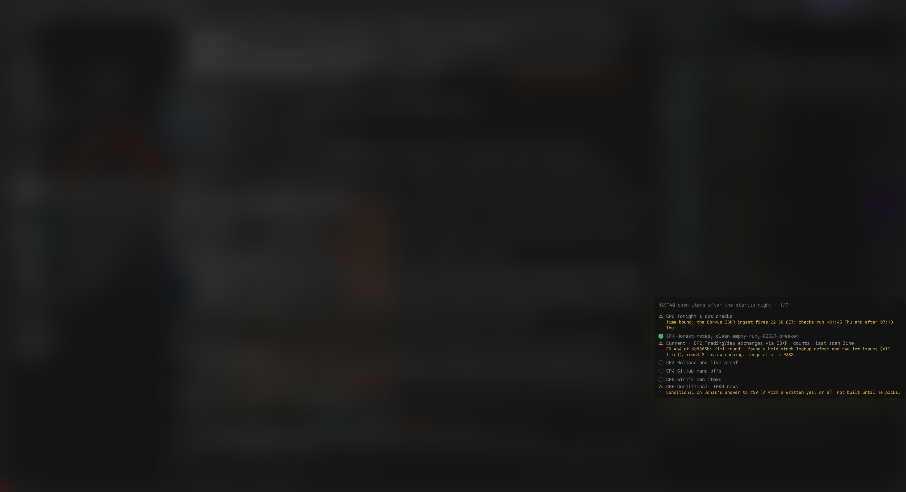

# TODO for Tern

TODO shows the active Glitch plan in a read-only Tern checklist. It displays the agreed checkpoints, tasks, file changes, steps and validation checks from the canonical plan. With Glitch off, TODO opens the session's native Tern board.

## Open the active plan

1. Enable **Do you use Glitch?** on the execution host. The installed package sets up eligible local Claude and Codex hooks. In a fresh Codex session, review and trust the TODO hooks through `/hooks`.
2. In a fresh native Tern agent pane, enter `/glitch-execute "plans/Example plan.md"` in Claude Code or `$glitch-execute "plans/Example plan.md"` in Codex. Use one explicit canonical plan path. A quoted path can contain spaces.
3. Click **TODO** in the status bar. If the current tab has exactly one real pane and it is eligible, TODO opens its plan view or native board directly. With multiple panes, no eligible pane or an ambiguous selection, TODO opens settings. Choose a session under **Attach to** when available.

## Status bar, settings and boards

The **TODO** status segment runs **TODO: Open** (`plugin.todo.open`). Only the current tab counts toward direct opening. Closed, parked, disconnected and ineligible panes cannot be chosen automatically. The Command Palette (`Ctrl+Shift+P`) also offers **TODO: Open Settings** (`plugin.todo.settings`) and **TODO: attach to this panel** (`plugin.todo.show`). When the **Plugin segments** widget is absent, the first window start asks once per installation whether to add it.

The settings pane has these fields:

1. **Attach to**: the live agent or terminal sessions that suit the current mode. Closed, parked or ineligible sessions never appear, and the choice is checked again right before TODO attaches, opens a board or syncs.
2. **Do you use Glitch?** Off by default.
3. Glitch **Off**: **Show the session's folder as a Tern Board?** (On by default) opens Tern's ordinary board (`TODO.md`) in the attached session's folder. This needs no plan, but the session must run on this computer, because a board is a file in that folder. When only sessions on other hosts are open, the list says so plainly and counts them. Off shows `No TODO source is enabled. Turn on the Tern Board option or enable Glitch integration in TODO Settings.`
4. Glitch **On**: **Sync Glitch Plan to Tern Board?** controls one-way sync and defaults to Off. The saved **Attach to** choice takes precedence over direct opens. If sync is on and no session is saved, the first confirmed direct plan view sets the choice. Settings show the board name and an **Open board** control after sync, or the condition preventing sync. If that plan view is waiting for a publication with sync on, it checks again every few seconds.

Settings are stored in the plugin's own key/value store with closed validation and safe defaults.

### Board sync (Glitch to Tern, one way)

With sync On, TODO keeps one managed board per stable plan (`<plugin data>/boards/<plan_id>.md`) with the lanes Pending, Active, Blocked and Done. Every checkpoint, task, file change, step and validation check is a card. A card's identity is its canonical id, kept in a `todo-id-<id>` tag, never its title or a native card id, so renames update in place and re-reading a plan changes nothing. Reordering changes nothing on the board. Changing a state moves the card to its lane. An entity removed from the plan has its managed card removed. A different plan id gets a different board; the old board is left alone. Cards without a `todo-id-` tag are never touched. Turning sync Off stops all writes and leaves the cards where they are; there is no cleanup.

**Size limits.** A plan can hold up to 500 checkpoints, tasks and items for viewing. A plan syncs to a board only up to **250** of them (`MAX_SYNC_ENTITIES` in `lib/board_sync.luau`). Above 250, sync is refused with a visible message in TODO Settings, nothing is written, and the plan view still works. The reason: Tern reads at most 500 cards from a board and cannot page, so two windows that both write a complete copy of the plan must still fit in one read. Then every duplicate is visible and the ordinary repair removes it. Your own cards on the board count toward the same 500-card read. When a read is cut short, TODO writes no new card and reports it; it only removes managed cards it can see to be duplicates or no longer in the plan. Tern's typings promise no card order inside a lane, so TODO never assumes its cards are read before yours. TODO never removes a card by counting. In a rare case where a closed window's board write lands very late, one duplicate card can remain visible until the next plan change or window reload. Tern edits never write to the Glitch plan. The synced board is a file in the plugin's data folder on the computer that runs the window, so the settings list offers the same sessions with sync On or Off. Board sync works when the session runs on another machine than this window: the plan view draws its validated plan into one hidden node of its own pane, and this window reads that node through the pane surface (the same way for a local session), so no machine's plugin store is shared. The window tells the view by event whether to keep waiting for a plan. A plan whose JSON is over 60000 bytes is never sent cut: the pane says it is too large. If a remote session's plan cannot be read, the pane says `Board sync for this session works only when the session runs on this window's machine.` The native board (Glitch Off) opens `TODO.md` in the session's folder through `cx.board`, which is desktop and local only, so it leaves sessions on other hosts out and says how many.

TODO is adapted from [Felipe Carneiro's session-list](https://github.com/felipevdc1/tern-session-list), MIT.



*The TODO checklist stays readable; surrounding panes and connection details are blurred for privacy.*

## Plan schema

`schema` 2 nests `checkpoints[] -> tasks[] -> items[]`. Checkpoints carry `id`, `text`, `state`, optional `reason` and optional `tasks`. Tasks carry the same fields and optional `items`. Items carry the same fields plus `kind` (`file`, `step` or `validation`); a `file` item also carries its `path`. `schema` 1 (checkpoints only) stays valid and readable. Ids are lowercase, unique across the whole plan and stable; the nesting itself is the parent link, so a parent reference cannot dangle. Several entities may be `active` at once (parallel builders); every one shows as active. `current` is optional: it is null or names one `active` or `blocked` entity, and a plan whose `current` names a pending, done or unknown entity is refused. A blocked entity needs a reason. Bounds: 30 checkpoints, 20 tasks per checkpoint, 30 items per task, 500 entities in all, 240 characters of text, 400 of reason.

## Scope

Interactive sessions only. The writer/executor updates the one canonical plan; the plugin displays its explicit checkpoint block. It never interprets dated prose as task completion, writes the plan, sends an agent prompt, adopts another task or grants release/deployment authority.

The panel binds to an explicitly selected source and stable `plan_id`. It does **not** follow another terminal's number. Restoring a view preserves that same source/id; replacing a file with a different plan is refused. A failed read clears previous success and shows an error.

While the selected plan is loading, the panel displays its reading status. A failed or ended source replaces the previous checklist with **Plan unavailable** and the diagnostic reason; it must not leave a blank panel or stale successful checkpoints. Loading, error and normal-plan views use container roots so Tern renders their contents.

## Planning integration

The companion contract in [integrations/glitch-plan-session-view/CONTRACT.md](integrations/glitch-plan-session-view/CONTRACT.md) describes how `/glitch-plan` adds the block and how its interactive executor maintains it. Keep normal Build choices, detailed tasks, dated Progress and the sole START HERE. Existing plans gain the block deliberately when resumed/revised; there is no bulk migration or inferred state.

Example (the helper generates a fresh stable plan id):

```sh
todo template --title "CSV import" --step "Implement the parser" --step "Prove the import" --step "Review and land the change"
```

Use the installed package’s absolute `bin/todo` path (`bin/todo.cmd` on Windows), or an optional PATH shortcut, for these CLI examples; the Tern installer does not add a command to PATH.

Canonical plan files use UTF-8 with LF or CRLF line endings. The reader never rewrites their bytes. The command prints a fenced JSON block between `<!-- TERN-SESSION:START -->` and `<!-- TERN-SESSION:END -->`; the agent places it in the canonical plan through its normal write path. States are `pending`, `active`, `blocked`, `done`. Several can be active at once (parallel builders). `current` is null or names one active or blocked checkpoint; blocked checkpoints require a reason. Stable ids survive description/reordering changes. The view never edits these fields.

The installed TODO host sets up the companion under `_local/tern-todo` on the execution account when Glitch is enabled. Plan creation maintains the block. Execute publishes the plan identity for the current pane. The hook leaves the plan bytes untouched. A deliberately resumed legacy plan without a checkpoint block gets one scoped `adopt` command. Its executor adds the agreed block through the normal plan workflow, then runs the exact command once. Other interactive agents can use the generic publisher. [Planning companion](integrations/glitch-plan-session-view/README.md)

## Platform and account boundaries

Linux multi-account viewing requires **both** successful native process inspection and host-readable canonical-plan paths. The Tern host account must be able to read the plan and traverse every ancestor directory, as well as inspect the publishing process chain. Sharing pointer metadata alone is insufficient. On the existing Linux estate, per-owner publication directories and records use the `agents` group's read access (`0751` directories, `0640` records/locks); only the owning account can write them. Group membership and plan-path access remain deployment prerequisites.

macOS and Windows publication stores are owner-only. macOS uses `0700` directories and `0600` files; Windows uses the native account's protected cache and ACL. Discovery does not read another account's store. Solo-Mac and solo-Windows use, plus the existing Linux multi-account estate, are the current qualification targets unless later evidence expands that scope. This target statement is not a claim that the pending real-device gates have passed.

Never work around an account or path boundary by copying canonical plans, automatically changing plan or ancestor permissions, or forwarding Tern/agent sockets. TODO changes modes only on its own publication metadata, never on canonical plans. Native process birth and ownership interfaces come with the OS; there is no new package dependency or listening service. An inaccessible process inspection remains a visible, nonterminal unknown; only a definitively ended or changed process is terminal.

On Windows, a handle-bound exit time is definitive even when another process retains the exited process's handle and it no longer appears in the parent snapshot. A missing parent for a still-live process remains unknown; access and enumeration failures are not treated as exit.

The CLI disables Python bytecode writes before loading its installed helpers, including when the native reader invokes Python with `-I`. Discovery and publication do not add `__pycache__` files to the plugin installation; intentional publication metadata remains in its separate native store.

Publication metadata is opened without following links and checked through the open descriptor/handle, including ownership, file type and link count. Permission migration acts on those already-checked objects, so a pre-placed symbolic link cannot redirect mode changes to another directory or a canonical plan. When pruning an old session's record, the helper takes that record's own lock and reads and validates it again; a different session's newer record is not removed using an earlier observation. TODO's Windows reader keeps the previous bytes when a checked replacement is installed while its handle is open; new readers see the replacement. All handles are closed. A read-only target is refused without changing either file or clearing its attributes. If installing a replacement fails, the previous valid publication stays in place. During initial discovery, a temporary access/unknown failure stays visible and retries so a later readable publication can appear. A real initial `ProcessEnded` instead emits `terminal=true` and exits the flow rather than retrying.

The outside/non-cooperating **same-record** cleanup limitation remains: comparing a record and then unlinking it is not atomic, and an outside writer can replace it between those steps. Cooperating per-record locks do not remove that race.

## Session discovery and source location

TODO resolves the pane's published canonical path and plan ID using its verified live process chain and ownership. Normal edits refresh without republishing. A changed plan requires deliberate reattachment. An ended process invalidates its old binding. Claude `/clear` clears the binding of the old conversation. Codex `/new` can leave it visible until the next input starts the new session. The generic interface for other interactive agents uses explicit clear before reset or exit.

Without an active publication, TODO shows **No active plan is published for this session** and leaves the agent running. Invalid metadata or inaccessible process inspection produces a diagnostic.

Local and native SSH Tern sessions use the same host-side resolver. The viewing client confirms the native split beside the selected session; the execution host resolves that split to its own process metadata, using only window keys its own daemon lists (the client window's key is never sent across), then reads its own published canonical file. Client-side pane handles are never interpreted as host CLI ids. The label shows Local or SSH and the native host. Raw SSH into a machine without native Tern ancestry is unsupported; there is no guessed local path or automatic secondary SSH login. If multiple native windows can claim the new TODO panel, membership is ambiguous and attachment fails closed rather than selecting a window or source arbitrarily. Attach again from one unambiguous window/layout.

Direct source checks (no Tern environment required):

```sh
todo source --plan /absolute/PLAN.md
todo source --plan /absolute/PLAN.md --ssh reviewed-host
```

The reader returns the validated checkpoint object. Each panel refreshes independently, every 1.5 seconds for local sources and 15 seconds for healthy SSH sources. An SSH read failure clears the previous success, then backs off from 60 seconds to five minutes. A successful read resets the delay. SSH uses an existing trusted host key. Usage and read errors return exit code 1.

## Runtime and rollout

The viewer requires **Tern 0.9.8 or later** on the server and client. The plan pane uses Tern's UI font, native checklist phases and source dock, which follow the active theme. Automatic setup on macOS, Windows and Linux requires Python 3.11 or later, a verified local Glitch root and the existing Glitch opt-in. A remote pane uses the hook on the machine where the agent runs. In Codex, approve the hook through its native trust prompt. [Validation record](docs/VALIDATION.md)

Install the reviewed package with Tern's ordinary installer:

```sh
tern plugin install /absolute/path/to/TODO
```

### Update

Run **TODO: Check for updates** from the command palette. When a newer version is on GitHub, **TODO: Update** installs it in place: it checks the release's requirements and asks first, and can also update connected remote hosts. Tern then reloads all its plugins, and your settings carry over. If ORCH+ is running a controller, run **ORCH+ Reconnect** afterwards.

The preview is not a pinned commit. Installation checks the actual package, requirements and load evidence; a different installed version is not the preview's success. If reload or missing process evidence leaves an uncertain result, use **TODO: Resolve update outcome**. It never repeats the install, and resolving as unverified does not certify success. A positively running installer cannot be overridden.

A copy installed before the updater existed needs one manual update:

    tern plugin install --force github.com/blastworksai/tools/plugins/tern/TODO

A linked development checkout (`tern plugin link`) is never updated by the plugin; `git pull` it yourself.

Plugin ID is `todo` and its displayed name is **TODO**. Install on the actual session host and client. The runbook covers setup, native trust, verification and rollback. [Rollout runbook](docs/RUNBOOK.md)

## Verification

```sh
python3 -m unittest discover -s tests -p todo_test.py
python3 -m unittest discover -s tests -p install_hooks_test.py
python3 tests/todo_smoke.py --published --evidence /absolute/private/evidence.json
```

The connected test uses a disposable Tern daemon, private Xvfb window and real loopback SSH server with generated temporary keys and strict host-key checking. It touches no live configuration or provider. It is designed to check source and restored identity, local/SSH state changes, visible failures and independent views. See [docs/VALIDATION.md](docs/VALIDATION.md) for the actual 0.6.0+ head, current helper hashes, executed results and every unrun native/real-device gate; loopback SSH is not proof of a remote Windows/macOS deployment.

The package contains only its active implementation and tests. Upstream legacy request, reminder and orphan-management code is not included.

## Attribution

Original plugin/native-checklist approach: Felipe Carneiro (`felipevdc1/tern-session-list`), MIT, based on f5920de0cc1018fa9814e5f0c6cca83a7ddf34dc. Original LICENSE remains. Explicit checkpoint reader, local/SSH source path and workflow contract: BlastworksAI, MIT. This fork does not claim independent origin of the native checklist design.
