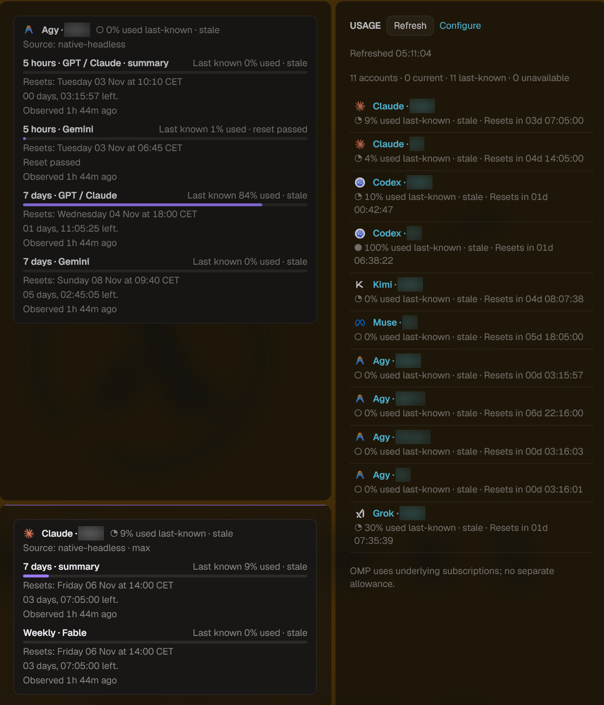
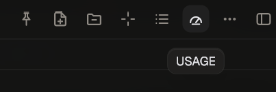

# USAGE for Tern

USAGE shows how much of each AI subscription you have used, for every account you defined in [SPAWN](../SPAWN/README.md), inside [Tern](https://docs.stencil.so/tern/).

```text
Codex · Work      ◔ 8% used · Resets in 03d 09:32:55
Claude · Personal ● 100% used · Resets in 01d 02:00:00
Muse · Main       ◔ 35% used last-known · stale · Resets in 01d 23:56:25
Kimi · Main       ◇ —  usage source could not read this account
```

USAGE reads the usage figures through each provider's own CLI or account endpoint, the same figures the CLI's `/usage` view shows. It does this headlessly: it never types into your agent sessions, never starts a model turn and never signs in for you. Percentages always mean **used**.



*Narrow sidebar with two account PIPs, taken on a pre-release build. Account labels are blurred. Wording and colours differ slightly in 2.0.0: the source reads "headless read", and current values use the [colour gradient](#reading-the-numbers).*

USAGE supersedes the older `tern-fleet-usage` plugin ("Agent Usage Block"). See [Moving from tern-fleet-usage](#moving-from-tern-fleet-usage).

## How it relates to SPAWN

SPAWN owns the account list. USAGE shows one row for every provider account in this machine's SPAWN roster, and nothing else:

- Add, rename or remove accounts in SPAWN, not in USAGE. There is no second enrollment.
- Accounts are never inferred from open panes, pane titles or cached readings.
- One account signed in on several machines is **one** account. When the same provider login turns up in the rosters of two machines, USAGE shows a single row and lists the other places it is configured. A hostname never makes a separate quota.
- The same login under two different SPAWN entries on one machine is shown as an identity conflict, because it is usually a mistake.
- OMP entries are listed separately as consumers. OMP runs on the subscriptions of the other providers and has no allowance of its own, so it never adds to the account count.

USAGE reads SPAWN's saved roster from SPAWN's plugin data on the same machine. SPAWN must be installed there and its Config must have been opened at least once.

## Requirements

| | |
| --- | --- |
| Tern | 0.9.10 or later, desktop (Linux). |
| SPAWN | Installed on the same machine, with your accounts defined in it. |
| Python | 3.11 or later, with `venv`/`pip`. USAGE installs its hash-locked dependencies (`aiohttp`, `cryptography`, `tzdata`; see `requirements.lock`) into its own private environment on first setup. That needs access to PyPI once. It never changes system packages. |
| Provider CLIs | Installed and already signed in, on the machine where SPAWN runs them. |
| Platform | **Linux.** macOS and Windows are not supported in this release (see [Limitations](#limitations)). iOS and Tern's web client cannot run the companion. |

### Supported providers

| Provider (SPAWN name) | How USAGE reads it | What you get |
| --- | --- | --- |
| Claude | Claude Code's saved OAuth login (`~/.claude/.credentials.json`, or the `--config-dir` SPAWN passes) and Anthropic's OAuth usage endpoint. | 5-hour, weekly and model-specific weekly windows. |
| Codex (OpenAI) | A private `codex app-server` process: account read plus rate-limit read. No conversation is opened. | 5-hour and weekly windows, plus a credit balance when Codex reports one. |
| Antigravity | `agy --print /usage`. | Separate Gemini and Claude/GPT pools (Antigravity reports *remaining*; USAGE converts it to used). |
| Grok | A private `grok agent stdio` process: subscription check and billing read. No session or model turn. | The current billing period. |
| Kimi | A private `kimi web --no-open` process on a random loopback port, stopped right after the read. | Kimi's enforced counters when it reports them. |
| Muse | `muse usage --json`, with Muse's auto-update turned off for the read. | Muse's cached allowance (see [Muse](#muse)). |

Other SPAWN providers appear as rows with no quota.

## Install

Install SPAWN first, then USAGE, on the machine whose SPAWN roster you want to see:

```sh
tern plugin install github.com/blastworksai/tools/plugins/tern/SPAWN
tern plugin install github.com/blastworksai/tools/plugins/tern/USAGE
```

This is Tern's documented form for a plugin in a repository subfolder ([Tern: Distribution](https://docs.stencil.so/tern/guides/distribution.html#finding-and-sharing-plugins)). Installing the repository root (`github.com/blastworksai/tools`) does **not** work, because the root holds no `plugin.toml`. Preferences › Plugins › **Install…** takes the same source string. Tern always installs from the default branch (`main`). To install a particular commit, clone the repository yourself and run `tern plugin install /path/to/tools/plugins/tern/USAGE`.

The plugin id is `usage`. Then:

1. Open **USAGE Setup** from the command palette. If USAGE has no private runtime yet, choose **Install private dependencies** and confirm. If Python is missing, use **Open official Python installer page**, or **Select existing Python interpreter** to point at a specific `python3` executable.
2. In **USAGE Setup**, choose **Allow headless usage reads**. Refresh does nothing until you allow it. You can stop it again from the same menu.
3. Choose **USAGE Refresh**, or press **Refresh** in the USAGE pane.
4. Optional: **USAGE Show Summary** turns on Tern's status bar with a short summary. If you hide the status bar later, USAGE respects that.

Tern plugins run with your OS account's access and are not sandboxed. Read the code before installing ([Tern: Trust](https://docs.stencil.so/tern/guides/distribution.html#trust)).

### Update

Run **USAGE Check for updates** from the command palette. When a newer version is on GitHub, **USAGE Update** installs it in place: it checks the release's requirements and asks first, and can also update connected remote hosts. Tern then reloads all its plugins, and your settings carry over. If ORCH+ is running a controller, run **ORCH+ Reload recovery guide** afterwards.

A copy installed before the updater existed needs one manual update:

    tern plugin install --force github.com/blastworksai/tools/plugins/tern/USAGE

A linked development checkout (`tern plugin link`) is never updated by the plugin; `git pull` it yourself.

Your settings, readings and pairings live in Tern's plugin data folder, not in the package, so they carry over. On its next start the companion notices the new release, backs up its database, migrates and removes the backup once the new version has started. If the start fails, it rolls back to the previous release.

### Remove

```sh
tern plugin remove usage        # or: tern plugin unlink usage, for a linked checkout
```

The background companion stops by itself about 90 seconds after the last USAGE window or block lets go of it. Tern keeps the plugin's data folder (`plugin-data/usage/`, see [Tern: Removing](https://docs.stencil.so/tern/guides/distribution.html#removing)), so reinstalling finds your settings again. To erase everything, delete that folder after removing the plugin. It holds the companion database (account labels, logins and readings), its owner-only access token, its TLS key and the private Python environment.

## Moving from tern-fleet-usage

`tern-fleet-usage` collected usage by typing `/usage` into idle agents and reading their replies. USAGE does not do that. Because the two plugins have different ids, Tern would happily run both, so remove the old one **first**:

1. `tern plugin remove tern-fleet-usage` (or `tern plugin unlink tern-fleet-usage` if you linked it). Its "Agent Usage Block" panes end at the next reload; close them.
2. Install SPAWN and define your accounts there, if you have not already.
3. Install USAGE as above and run **Refresh**.

Nothing is deleted. Tern keeps `plugin-data/tern-fleet-usage/` after removal, and USAGE does not touch it. USAGE also does not import it: the old snapshot was labelled by pane title and cannot be tied to a provider account. Until the first Refresh, rows show "not measured yet" instead of the old values. Delete the old folder by hand when you no longer want it.

## Using USAGE

### Commands

| Command | What it does |
| --- | --- |
| **USAGE Details** | Opens the USAGE pane in your saved layout, or focuses it if it is already open. The speedometer button in the Files pane header does the same. |
| **USAGE Refresh** | Starts one refresh for every account. Repeated requests while it runs join the same refresh. In a window attached to a remote Tern host, it refreshes that host (see [Configuring an attached remote host](#configuring-an-attached-remote-host)). |
| **USAGE Configuration** | Layout and refresh interval. The × in its top-right corner closes it. |
| **USAGE Setup** | Private runtime, headless-read permission, summary, capacity export, account bindings and optional sharing. In a window attached to a remote Tern host, it configures that host (see [Configuring an attached remote host](#configuring-an-attached-remote-host)). |
| **USAGE Show Summary** | Turns the status-bar summary on once. |
| **USAGE Diagnostics** | Companion, refresh and sharing state. |
| **USAGE Check for updates** | Checks GitHub for a newer USAGE release (see [Update](#update)). |
| **USAGE Update** | Shown once a newer release is known; installs it after asking (see [Update](#update)). |

The speedometer button in the Files pane header opens the same view:



### Layouts

| Layout | Where | Shows |
| --- | --- | --- |
| **Narrow** (default) | A sidebar split to the right of your current pane (22% wide). | One compact row per account. Clicking an account opens a floating account PIP with its full details. |
| **Wide** | A wider sidebar (45%). | Full detail cards for every account. |
| **Bottom** | A split below your current pane (22% high), as wide as that pane. | Compact rows that wrap onto as many lines as the roster needs. |

The number of rows always follows your SPAWN roster; there is no fixed limit. USAGE panes are ordinary Tern panes: resize them, and scroll when the roster does not fit. The layout choice is stored per Tern installation and survives reloads. Changing it only replaces USAGE's own pane and never moves or closes your other panes. Account PIPs show only that account and have no Refresh or Configure buttons of their own.

Provider icons appear in every layout.

### Refresh and the interval

- Refresh is **manual by default**. In **USAGE Configuration** you can pick Manual, 1 min, 5 min, 15 min or Custom (60–86,400 seconds). The interval is saved by the companion and survives restarts and reloads.
- A refresh reads every account once. At most two provider reads run at a time, and accounts that share the same OS user and provider profile are read once.
- Going back to Manual stops future automatic refreshes. A refresh that is already running is allowed to finish.
- Countdown timers, polling and reopening panes never contact a provider. Only a refresh does.
- The status line reports progress, the time of the last completed refresh and how many accounts had a problem. The Configuration pane lists each problem.

### Reading the numbers

**Used, not remaining.** Every percentage is the share of the quota already used. A full bar means 100% used. Where a provider reports *remaining* (Antigravity), USAGE converts it.

**Colours.** Current percentages and their ring are coloured on a gradient from green (0% used) to red (100% used), in 10% steps. Last-known, stale and unavailable values stay grey, so an old reading never looks live. The status-bar summary uses Tern's three status tones: green, amber from 70% and red from 90%.

**Compact rows** show one quota per account: a measured weekly quota when there is one (the account-wide pool before model-specific pools), otherwise the next measured window. The countdown next to it belongs to that same quota:

```text
8% used · Resets in 03d 09:32:55
```

`03d` means **3 days left**, not a date. The countdown ticks every second without contacting the provider. When the reset time passes it says **Reset passed**, and the value becomes last-known until the next refresh. When the provider gave no reset time, no countdown is shown; USAGE never makes one up.

**Detail cards** (wide layout and account PIPs) list every window separately, for example 5-hour, weekly and model-specific weekly quotas, each with its own bar, reset date and time zone, countdown and the time it was measured.

**Current, last-known and unavailable.** The header always accounts for the whole roster, for example `14 accounts · 7 current · 2 last-known · 5 unavailable`:

- **current**: measured by the latest read and still inside its window;
- **last-known**: an earlier measurement, kept with its original measurement and reset times because the latest read failed, the reset has passed or the reading is old (`stale`);
- **unavailable**: never measured, or nothing usable to show. The row says why, for example "usage credentials unavailable on source", "signed in with an API key; no subscription quota", "provider login expired; open the provider's CLI once to renew it", "runs on another machine over SSH", or "headless usage reads are off".

Unknown usage is never shown as 0%. A real 0% is shown as 0%.

**Credit balances.** When Codex reports a finite credit balance, the detail card shows *Last reported balance: N credits remaining*. It is separate from the rolling quota percentages and never mixed into them. Missing, unlimited or malformed balances are not shown, and a failed read drops the balance rather than presenting an old one as current.

USAGE never adds quotas together across accounts or agents. It also hides Anthropic's internal placeholder windows (for example `iguana_necktie`), which are not quotas you can act on.

### OMP

OMP has no allowance of its own. Its rows are listed under OMP as consumers of your other subscriptions and never count as accounts. To let ORCH+ route an OMP record by quota, associate it with a bound account (see [Capacity export](#capacity-export-for-other-plugins-orch)).

### Muse

`muse usage --json` reports a cached allowance that Muse normally fills in only after you have used Muse for a real turn. USAGE never creates that turn. Until one has happened, Muse shows **Awaiting usage after a turn**, not 0%. When a cached allowance exists, USAGE keeps Muse's own measurement time, so an old cache shows as last-known/stale instead of looking fresh.

### Logins are not the same as quota credentials

"Usage credentials unavailable on source" means USAGE could not find the saved subscription login it reads quota with. It does **not** prove the interactive CLI is signed out. For example, a shell that exports `CLAUDE_CODE_OAUTH_TOKEN`, or a CLI configured with an API key, can run normally while there is no saved subscription login for USAGE to read. USAGE does not read shell profiles, does not take tokens from running sessions and does not refresh tokens itself. An expired Claude login is reported as expired and is not sent anywhere; opening Claude once normally renews it.

## Configuring an attached remote host

USAGE reads and refreshes on the machine that runs the Tern host. When your window is attached to a remote Tern host (a VM, say), that host is the source: its SPAWN roster, its provider logins and its own USAGE companion. USAGE blocks opened in that session show the host's readings, and ORCH+ reads the host's capacity export. You need no Tern window running on the host itself.

When the current session's host is remote, **USAGE Setup** configures that host and names it everywhere:

- The picker is titled `USAGE Setup — host <name> (attached source) · <role> · <installation UUID>`. A toast says "USAGE Setup configures host <name>".
- Every row and every confirmation names the host, for example **Allow headless usage reads on vm-b** or **Host vm-b · Bind this SPAWN account to its signed-in login?**. After a change, the toast reads "USAGE configuration saved on host <name>".

The rows:

- **Install private dependencies on <name>**, offered when the host's runtime isn't ready. Python 3.11+ must already be installed on the host.
- **Allow / Stop headless usage reads on <name>**.
- **Enable / Revoke capacity export on <name>**.
- **Bind SPAWN accounts on <name>…** and **Associate OMP records on <name>…**, shown while the host allows headless usage reads.
- **Configure this window's machine instead** opens the ordinary Setup for the machine running the window: pairing, summary, interpreter choice and its own permissions.

Each change needs the same explicit confirmation as local Setup; attaching enables nothing. Setup sends the confirmed change to the host's **USAGE Configuration** block. If none is open in the session, Setup opens one beside your current pane without taking focus. The block runs the change with the host's own companion and shows the result. It accepts only the operations listed above: it can't enable sharing, pair, refresh or change any other setting.

**Who counts as the owner.** USAGE treats a Tern remote attach as the host's local owner, because attaching requires your key in the host's authorized keys and runs as the same OS user there. Anything able to attach as that user can already run commands on the host. As with the capacity export, a Tern block event doesn't prove that a person clicked; the confirmation in Setup is the consent USAGE asks for.

**Refresh.** In a window attached to a remote host, **USAGE Refresh** refreshes the host, not the window's machine. It sends the request to a USAGE pane (Details, an account PIP or Configuration) already open in the attached session; the toast reads "USAGE refresh on host <name>" and progress shows in that pane. It never opens a pane: with none open, the toast says so, and you open **USAGE Details** first. The Refresh button in the host's USAGE pane does the same.

A window on a local host keeps using its own companion exactly as before, for Setup and for Refresh.

## Optional sharing between machines

By default every installation is **standalone**: nothing listens on the network and nothing is exported. Sharing is opt-in on each machine.

1. On the machine that should collect everything (the *hub*): **USAGE Setup › Share from this installation**. Enter an explicit interface IP (no wildcard), a TLS port (1024–65535) and a recipient group name, then confirm the listed export fields. USAGE does not open firewall ports.
2. **Create invitation and copy** copies a one-use invitation that expires after ten minutes. It contains a pairing secret, so send it privately. The clipboard is not cleared automatically.
3. On the other machine: **Join using an invitation**. Check the hub id, group and certificate fingerprint, then choose **Receive only** or agree to share this machine's accounts with the group.
4. **Revoke peer / unpair** removes a pairing. **Standalone / stop sharing** leaves the hub, revokes listed peers and stops listening. Data a peer has already received cannot be recalled.

A member forwards only Refresh, status and interval changes to its hub. The hub's own SPAWN roster, logins and headless-read permission decide what is read. Pairing never grants remote command execution, and a SPAWN `ssh-command` account is never read over SSH: install USAGE on that machine and share it instead.

Hub and members should run the same USAGE version. Update them together.

**What is shared:** provider, account identity (often an email address) and label, organization/workspace scope, subscription, quota windows, reset and measurement times, and source label, plus the SPAWN account and provider labels and any account-binding evidence (SPAWN catalog join, definition revisions, bound login IDs). **Never shared:** credentials, terminal output, SPAWN commands and paths, OS user names and provider profile paths.

Every peer connection pins the hub's TLS certificate. Redirects, proxies, wrong pins, replayed publications and invitation reuse are rejected. The owner-only control channel listens on loopback only and is protected by a random token in an owner-only file.

## Capacity export for other plugins (ORCH+)

Other Tern plugins running as the same OS user, such as [ORCH+](../ORCH+/README.md) quota routing, can read USAGE's evidence through the read-only `usage.capacity` block. It is **off by default** and carries quota only for accounts you bind.

1. **USAGE Setup › Enable capacity export** and confirm. **Revoke capacity export** turns it off and invalidates snapshots already handed out. In a window attached to a remote host, this and the binding rows below configure that host ([Configuring an attached remote host](#configuring-an-attached-remote-host)).
2. Allow headless usage reads and refresh once, so each account has a current reading.
3. **USAGE Setup › Bind SPAWN accounts…** (shown while headless usage reads are allowed) lists every SPAWN account with the login its latest current reading proved, for example `Claude · Work → you@example.com`. Pick one; the confirmation shows the provider, the SPAWN record, the principal and its identity scope. Confirm to bind it. Picking a bound account offers **Revoke binding**.
4. Optional: **USAGE Setup › Associate OMP records…** declares which bound account's quota an OMP record uses. USAGE cannot read OMP's own login, so this is your declaration, not a measurement.

A binding ends by itself, and must be confirmed again, when you edit that SPAWN record or a reading proves a different login. While a reading is unavailable, last-known or missing, the binding is left out of what USAGE publishes. Stopping headless usage reads hides every binding until you allow them again.

**What the export contains:** the version-1 document (`records`, `sources`, `current_roster`, `current_source_id`, `stale_after_ms`, `quota_unit`), the SPAWN catalog join (`spawn_join`) and each account's `definition_revision`, and, for bound accounts only, `profile_binding` with the readings and quota windows that prove it. Unbound accounts are listed without readings or quota. **Never exported:** credentials, SPAWN commands, arguments, OS user names and profile paths. Capacity reads cannot refresh, configure or launch anything.

## Privacy and permissions

- **What a read touches.** Claude: the saved OAuth login file, then `https://api.anthropic.com/api/oauth/usage`. Codex, Grok, Kimi, Muse, Antigravity: the provider's own CLI, run with an empty working directory, no terminal and a minimal environment. Antigravity identity uses Google's userinfo endpoint. Kimi's local web server is bound to loopback and stopped after the read.
- **What leaves the read.** Only normalized identity and quota fields. Raw responses, tokens and error text are never stored or logged.
- **Other OS users.** If a SPAWN account names an OS `user`, USAGE reads it as that user with `sudo -n -u USER`, which only works if you already allow that without a password. The Python interpreter must be executable by that user, and the provider CLIs must be on `/usr/local/bin`, `/usr/bin`, `/bin`, or that user's `~/.local/bin` or `~/.bun/bin`. USAGE copies a small helper (code only, no credentials) to a temporary directory for the read and deletes it afterwards.
- **Seat launchers.** A SPAWN account whose command is `/absolute/path/seat-agent-entry <user>`, with `<user>` the account's own OS `user` and no other arguments, is read as that user's default provider context. USAGE trusts the launcher only when root owns it and every directory above it and none of them is writable by group or others; any other shape is reported as "account context could not be verified".
- **Stored data.** The companion database in `plugin-data/usage/companion/` keeps account labels, logins and readings. It is owner-only. USAGE writes nothing into the package directory.

## Troubleshooting

| Symptom | What to do |
| --- | --- |
| "0 accounts" or "Define accounts in SPAWN" | Install SPAWN on this machine, define accounts and open SPAWN's Config once. USAGE reads SPAWN's saved roster, not open panes. |
| "headless usage reads are off" | **USAGE Setup › Allow headless usage reads**. |
| "USAGE setup is required" | **USAGE Setup › Install private dependencies**. It needs Python 3.11+ and access to PyPI once. In a window attached to a remote host, the row is **Install private dependencies on <host>**, and Python and PyPI access are needed on that host. |
| "USAGE is not ready on host <name>" | Install USAGE on that host (the [Install](#install) steps, run there) and reload it. Setup in an attached window configures the host's USAGE; it can't install the plugin. |
| "usage credentials unavailable on source" | Sign in once with the provider's own CLI as the OS user SPAWN uses, then refresh. An env-token or API-key setup can work interactively without a saved subscription login. |
| "provider login expired" | Open the provider's CLI normally once so it renews its login, then refresh. |
| "signed in with an API key" | That login has no subscription quota to show. |
| "account context could not be verified" | The SPAWN command passes a flag that can switch accounts or profiles (for example `--profile` or an auth override), or wraps the provider CLI in a launcher USAGE can't see into. USAGE won't guess which account that is. Point the command at the provider CLI itself, or use a root-controlled [seat launcher](#privacy-and-permissions). |
| "runs on another machine over SSH" | Install USAGE on that machine (and share it, if you like). |
| Muse "Awaiting usage after a turn" | Use Muse normally once; USAGE will not start a turn for you. |
| Hub listener problem in Diagnostics | The saved sharing address is not available (for example after a network change). Choose **Share** again with a current address, or **Standalone**. Local use keeps working meanwhile. |

**USAGE Diagnostics** shows the companion state, the last refresh and its problems, sharing state and whether the summary is hidden. Tern's own logs (`tern-daemon.log` for the host half, `tern.log` for windows) contain plugin load errors ([Tern: Debugging](https://docs.stencil.so/tern/guides/debugging.html)).

## Limitations

- **Linux only for this release.** macOS is untested; Claude Code on macOS keeps its login in the Keychain, which USAGE does not read. Windows is untested, and the companion's file-permission checks are known to be slow there.
- Usage is read from each provider's current CLI or endpoint. A provider can change its output; USAGE then reports "could not parse" rather than guessing.
- A SPAWN account that runs over SSH is shown but never read from this machine.
- Accounts on another machine show up only when that machine runs USAGE and shares with this one, or when your window is attached to that machine's Tern host.
- In a window attached to a remote host, the status-bar summary and USAGE Diagnostics still describe the window's own machine. USAGE blocks opened in the attached session describe the host. The **USAGE Refresh** command needs one of those blocks open to reach the host.
- Codex readings without an email (rare) are shown without an account identity and are not merged with other rows.
- USAGE needs Python and a one-time dependency download. It does not install Python for you.

## Development and tests

The pure Luau modules are tested inside a real Tern desktop, the Python companion with `unittest`. Never run the Luau suites against your everyday Tern window: start a separate desktop with its own `TERN_CONFIG_DIR`, `TERN_DAEMON_SOCKET` and `STENCIL_LOG_DIR`, link the package there, and give it a control endpoint (see the [tern-plugin-development skill](../../../skills/tern-plugin-development/SKILL.md) for a complete isolated setup).

```sh
# Python companion (needs the packages from requirements.lock)
PYTHONPYCACHEPREFIX=/tmp/usage-pycache python3 -m unittest discover -s tests -p 'test_*.py'

# Luau suites, in the isolated desktop started with: tern --control /path/to/window.sock
python3 tools/verify.py --control /path/to/window.sock --suite all
python3 tools/verify.py --control /path/to/window.sock --suite presentation
```

`tools/verify.py` runs each `tests/*.luau` suite through Tern's Carly Lua tool (`tern ctl … carly lua`), which records a Carly conversation turn but makes no model request. It checks Carly's result for each suite, prints each suite's `PASS` line and exits non-zero on any failure, timeout or missing suite. `--tern` selects the Tern executable and `--timeout` the per-suite deadline. One Python test is Windows-only and is skipped elsewhere.

All fixtures are synthetic. Keep runtime data, logs and screenshots out of the package directory: Tern reloads a linked plugin whenever anything in it changes.

### Files

- `plugin.toml`: manifest (id `usage`) with the accounts, account, config and capacity blocks.
- `window.luau`, `setup.luau`, `view_layout.luau`, `view_state.luau`, `usage.css`: commands, Setup, layouts and PIPs, refresh progress, styles.
- `host.luau`, `presentation.luau`: the USAGE blocks and what they show.
- `capacity.luau`, `usage_service/capacity.py`: the read-only `usage.capacity` export.
- `host_setup.luau`: host-run Setup for windows attached to a remote host (the `usage.setup` action on the config block).
- `snapshot.luau`, `aggregate.luau`, `roster.luau`, `accounts.luau`, `identity.luau`, `enrichment.luau`: validating readings, matching them to SPAWN accounts and grouping windows.
- `source_collect.luau`, `metadata_runner.luau`, `companion.luau`: publishing refresh results and talking to the Python companion.
- `usage_service.py`, `usage_service/`: the companion (lifecycle, storage, refresh, SPAWN roster and account bindings, provider readers, sharing, capacity export).
- `provider_metadata.py`, `metadata_providers.py`: the read-only helper that runs as the account's OS user.
- `requirements.lock`, `pyproject.toml`: locked Python dependencies.
- `requires.json`: the minimum Tern version this release needs, checked by **USAGE Update**.
- `updater/`: the updater modules, vendored by `shared/tern-updater/sync.py`; don't edit them here.
- `tests/`, `tools/verify.py`: test suites and the Luau runner.
- `assets/screenshots/`: the screenshots in this README (account labels blurred).

## License

MIT. See the repository [LICENSE](../../../LICENSE). Python dependencies keep their own licences.
