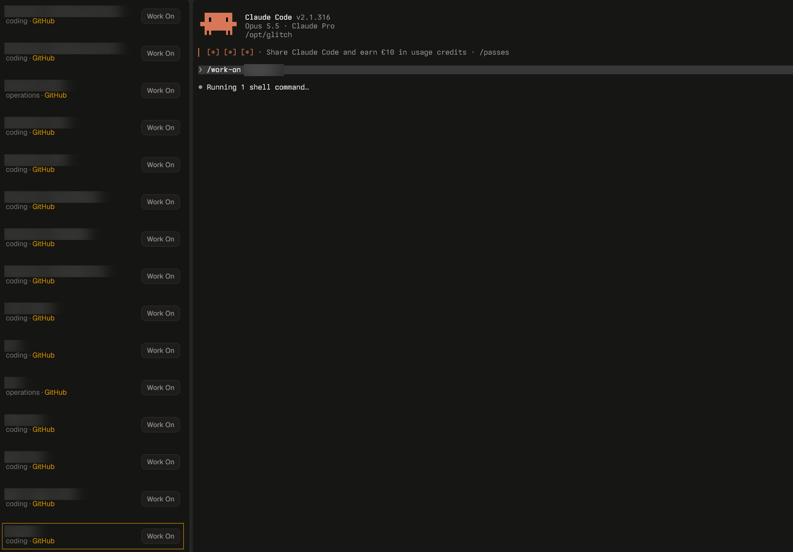
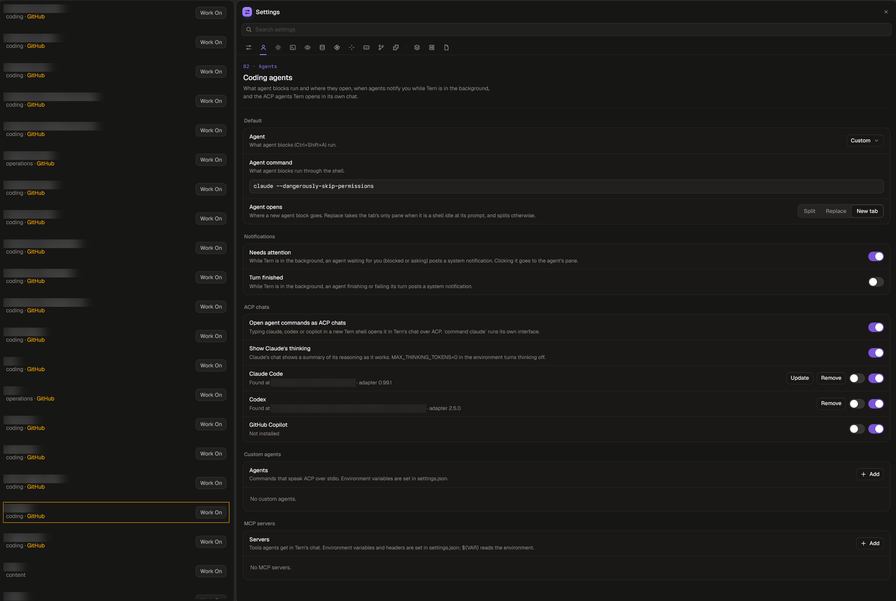

# WORK for Tern

WORK is a native Tern pane for active Glitch workspaces. It reads the same generated workspace registry used by `/work-on`, so the list stays current without a second project catalog.



*After **Work On**: the default agent opens to the right of WORK at the Glitch root, already running `/work-on <workspace-slug>`. Workspace names are blurred.*

## What it does

- Lists every registry entry whose `status` is `active`.
- Shows each workspace's kind and configured GitHub repository.
- Selects a row when you click it and remembers the selection locally in Tern KV.
- Opens the repository's GitHub URL through Tern's normal link handling.
- **Work On** starts Tern's default agent at the Glitch root, in a split to the right of the WORK pane in the same tab, with the prompt:

  ```text
  /work-on <workspace-slug>
  ```

The agent starts at the Glitch root because `/work-on` is a Glitch skill: an agent started inside a workspace cannot see it. It opens beside WORK whatever Tern's "Agent opens" setting says, and with several Tern windows showing the same session only the window you clicked in starts it.

Workspaces are discovered from `workspaces/registry.json`; names are never hardcoded into the plugin. Worktrees, mirrors and failed registry entries are omitted because `/work-on` does not treat them as independent workspaces.

## Choosing the agent

Work On runs whatever Preferences › Coding agents › **Agent** is set to (`agent_command` in Tern's `settings.json`). Pick **Custom** and enter a command, such as `claude --dangerously-skip-permissions`, to run that CLI in its own interface. **Claude Code** opens Claude in Tern's ACP chat instead.



*Agent set to **Custom** with `claude --dangerously-skip-permissions`. Workspace names and local paths are blurred.*

A CLI agent (`claude`, `codex`, `omp`) receives the prompt as its launch argument, so it runs as soon as the CLI is up, including after Claude Code's first-run folder-trust question. Tern's own ACP chat (`tern acp …`) receives it through Tern.

## Install

Install WORK on the Tern host that owns the Glitch workspace registry:

```sh
tern plugin install github.com/blastworksai/tools/plugins/tern/WORK
tern plugin reload tern-work --json
```

Then run **WORK** from Tern's command palette. The plugin can run locally on the same machine as Glitch or with Tern connected to a remote Glitch host. In either case, the host half must be attached to the Glitch root containing `workspaces/registry.json`.

For a local Glitch checkout, link the package from that checkout's `_local` directory if you want automatic root discovery:

```sh
tern plugin link <glitch-root>/_local/tern-projects
tern plugin reload tern-work --json
```

Windows paths are supported; the plugin normalizes path separators before locating the Glitch root.

## Registry contract

The registry is expected to have this shape:

```json
{
  "workspaces": {
    "example": {
      "status": "active",
      "kind": "coding",
      "path": "example",
      "remote": "https://github.com/example/example"
    }
  }
}
```

Only safe workspace slugs and paths are displayed. GitHub links are accepted only for `https://github.com/...` URLs.

## Files

- `plugin.toml` — Tern plugin and block declaration
- `host.luau` — host-side block registration
- `window.luau` — WORK command, files-pane button and native agent launch
- `projects.luau` — registry loading, validation and workspace view model
- `blocks/panel.luau` — workspace list and row actions
- `styles.css` — amber Work On button styling
- `tests/projects.luau` — registry/filtering/selection regression checks
- `assets/screenshots/` — README screenshots

## License

MIT. See the repository license.
