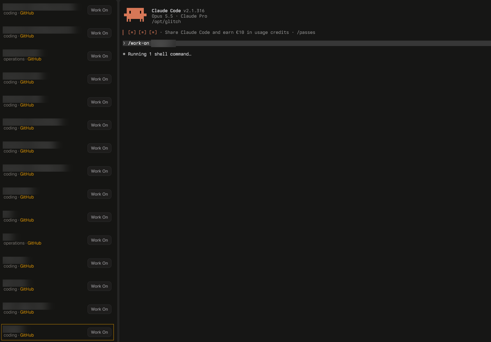

# WORK for Tern

WORK is a native Tern pane for active Glitch workspaces. It reads the same generated workspace registry used by `/work-on`, so the list stays current without a second project catalog.



*After **Work On** with ACP, the configured host agent opens beside WORK and Tern queues `/work-on <workspace-slug>` for native delivery. Workspace names are blurred.*

## Qualification status

This revision does **not** yet claim qualified real-device support on macOS, Windows, Linux, remote/mixed-OS installations, or full multi-window operation. Source fixtures exercise configuration, command construction, direct-origin routing and clipboard behavior, but they are not native GUI or installed-package acceptance. The remaining gates are listed under [Acceptance and remaining gates](#acceptance-and-remaining-gates).

## Opening WORK

- Click the **WORK** segment (list icon) in Tern's status bar. Clicking it again with a WORK pane open in the tab closes that pane and returns focus to your previous pane.
- Or run the Command Palette command `WORK` (`Ctrl+Shift+P` is the fallback when the status bar is hidden).
- On first start, if the **Plugin segments** widget is not in the widget bar, WORK offers once per install to add it. WORK no longer adds a button to the Files pane.

## What it does

- Lists every registry entry whose `status` is `active`.
- Shows each workspace's kind and configured GitHub repository.
- Selects a row when you click it and remembers the selection locally in Tern KV.
- Opens the repository's GitHub URL through Tern's normal link handling.
- **Refresh** rereads the host configuration and registry without reopening the pane. A read/configuration error is shown separately from a valid registry with no active workspaces.
- **Setup** configures the ACP or CLI agent on the execution host. **Work On** uses that host-owned configuration, not a desktop client's Coding agents preference.
- **Work On** starts one configured agent beside the clicking WORK pane and prepares the prompt below. WORK cannot start SPAWN agents, and saved SPAWN agents add nothing to the workspace cards.

  ```text
  /work-on <workspace-slug>
  ```

Every configured-agent launch uses the loaded `catalog.root` as its working directory: the agent starts at the Glitch root because `/work-on` is a Glitch skill, and an agent started inside a workspace cannot see it. The individual workspace directory is not used as the launch directory.

Workspaces are discovered from `workspaces/registry.json`; names are never hardcoded into the plugin. Worktrees, mirrors and failed registry entries are omitted because `/work-on` does not treat them as independent workspaces.

## WORK ON inside ORCH+

ORCH+ requires WORK only when **Glitch Integration → Enable Work On** is enabled. With Glitch off, WORK ON is hidden and WORK is not a dependency.

In this mode, WORK opens a native selection pane for active Glitch projects and their unarchived plans. Select an existing project/plan or create a new orchestrated project. WORK returns the structured selection to the requesting ORCH+ pane and waits for its acknowledgment; it does not start WORK's separate configured ACP/CLI agent.

A clean installation can set the Glitch root in this selection pane. This saves a root-only WORK configuration; a standalone WORK agent is not required. The root is the execution host's folder containing `workspaces/registry.json`, not a hardcoded folder or a desktop path on a remote connection. Ordinary WORK setup and its standalone Work On behavior below remain separate.

Adding the selection to ORCH+ does not START the imported plan, resume paused work or alter another project's agent. Use ORCH+'s project controls or an explicitly configured automatic-start policy.

## Native WORK Setup

Configuration belongs to the **execution host that owns the Glitch registry**. It lives in `config.json` in WORK's persistent native data directory (`tern.plugin.data`), outside the installed or linked package. An unconfigured pane displays the exact filename. On Linux with the default native state directory it is `~/.local/state/tern/plugin-data/tern-work/config.json`; a custom `TERN_CONFIG_DIR` changes that location.

Open **WORK → Setup** to:

- enter the absolute Glitch root on a fresh installation, or review an existing root shown as **Glitch root (preserved)**;
- choose **ACP - Recommended** (Tern's native queued prompt) or **CLI - Manual Paste Req.** (copies `/work-on <slug>` to the clicking window's clipboard);
- edit the executable (labelled **Command**) and each later argument (**Option 1**, **Option 2**, ...) as separate native fields;
- add or remove options with **Add option**, then choose **Save Setup**.

The screen opens with the line "Choose which agent opens when you click Work On.". The empty Glitch root box shows the placeholder "Your Glitch folder, e.g. /opt/glitch or C:\Users\you\Glitch"; WORK does not detect a folder. A grey hint under the rows reads "Starts Tern's own agent pane." (ACP) or "Starts Claude Code in a terminal." (CLI) only while the rows equal that kind's defaults; editing, adding or removing a row hides it. An untouched Setup with no Glitch root shows a calm instruction instead of the `setup_required` error; the red error appears only after a Save Setup or Refresh attempt.

Setup checks for external edits before it saves and verifies the saved configuration by reading it back. JSON at `config.json` is recovery only. This explanation is documented here and no longer shown on the Setup screen.

A fresh Setup opens with ACP and `tern acp` as two argv entries (`["tern", "acp"]`). Changing **Agent kind** loads that kind's default argv: CLI becomes `["claude"]`, and returning to ACP restores `["tern", "acp"]`. This replaces argv edits made under the previous kind, so review the entries before saving. Enter an absolute executable path when the host's GUI `PATH` is insufficient. An argv is a nonempty dense array of at most 64 strings, each at most 4096 bytes and without control characters. The executable must not be empty; later empty arguments are retained. WORK never splits a combined command string, so quotes and spaces inside one entry remain literal argument content.

Examples of host-local values, not evidence of platform qualification:

- **macOS ACP:** `glitch_root` such as `/Users/user/Glitch`, with argv `["/opt/homebrew/bin/tern", "acp"]` when Tern is installed there.
- **macOS CLI:** the same host root, with argv such as `["/opt/homebrew/bin/claude", "--dangerously-skip-permissions"]`.
- **Windows ACP:** `glitch_root` such as `C:/Users/user/Glitch`, with argv `["tern.exe", "acp"]` or an absolute host executable path.
- **Windows CLI:** the same host root, with argv such as `["claude.exe", "--dangerously-skip-permissions"]`. Drive and UNC roots are accepted; escaped backslashes are valid JSON too. An explicit `.cmd` or `.bat` target is rejected before launch, and a target that resolves to a batch file also fails closed. Native `.exe` and PowerShell-script launch routes remain implemented, but their real Windows behavior is still unqualified.
- **Remote host:** use the remote execution host's Glitch path and executable, even when the clicking desktop runs another OS. For example, a Windows desktop attached to a Linux Glitch VM uses the VM's `/opt/glitch` and the VM's agent argv, never a Windows client command.

A fresh ordinary installed package with no configuration opens Setup with an empty, editable **Glitch root** field. Enter the absolute folder containing `workspaces/registry.json`, choose and edit the agent, then save; no JSON step is required. The root is the host's Glitch folder, not the registry filename or an individual workspace.

An existing explicit `glitch_root` is displayed and preserved read-only while the agent is edited. To repair an invalid configuration or change an existing root, use JSON recovery at the displayed native-data filename and then **Refresh**. JSON is recovery only, not the normal setup or agent editor, and it is never a fallback to a client preference.

For a legacy linked checkout, WORK can infer the Glitch root from `_local/<package>` only when `config.json` is absent:

```sh
tern plugin link <glitch-root>/_local/tern-projects
tern plugin reload tern-work --json
```

That inferred root lets native Setup save the agent without separate root JSON. An explicit configuration always takes precedence. An unreadable, malformed or incomplete explicit configuration is a visible hold, never a reason to try another root or a desktop command.

### Persistence, upgrades and external edits

The complete configuration has this shape:

```json
{
  "glitch_root": "/opt/glitch",
  "agent": {
    "kind": "acp",
    "argv": ["tern", "acp"]
  }
}
```

Use `"kind": "cli"` for a CLI. The native data file persists across in-place plugin updates and reloads and is independent on every execution host; it is not synchronized between hosts or stored as a shared window preference.

- A 0.5.0 installation with no configuration holds for **Setup** with an editable root; it does not silently select a root or agent.
- A 0.5.1 root-only configuration displays and preserves its existing root while holding for ACP/CLI Setup; it does not silently select an agent.
- A linked legacy copy can retain its inferred root, but still requires agent Setup.
- Missing, unreadable or invalid configuration produces `setup_required` or `config_invalid` as appropriate. Registry read and validation failures remain separate `registry_unreadable` and `registry_invalid` states.
- Setup snapshots the file when opened. An external change, malformed existing JSON, unknown field (including one set to `null`), or incomplete existing agent produces a visible hold without rewriting the file and with no claimed compare-and-swap. No configuration field accepts JSON `null`; omit an absent agent for a root-only upgrade. Repair through JSON recovery when instructed, then **Refresh**.
- Save validates the complete document, refuses encoded output larger than the 32 KiB read limit before writing, writes it on the host and reads it back. A failed read-back remains a visible hold.
- A displayed catalog and its actions retain the loaded root and agent until **Refresh**; external edits do not silently retarget an existing list.

There is no fallback to Preferences › Coding agents › **Agent**, `agent_command`, or any other client-side command. Configure every execution host independently.

## Prompt delivery and the clicking window

Direct WORK links carry the clicking WORK pane as their origin. A link whose origin is not a live WORK panel is refused; window focus is not launch authorization.

Prompt delivery depends on the selected configured-agent route:

- **Configured ACP:** WORK uses Tern's native ACP prompt queue. The toast says that Tern will submit only when native input is ready. Actual provider readiness remains a native acceptance gate.
- **Configured CLI:** WORK starts the host command without putting `/work-on` in its argv, then copies `/work-on <workspace-slug>` through the **clicking window's** `WindowCx`. That client's clipboard is replaced; there is no host-wide clipboard broadcast. Paste into the new agent only when its own prompt is ready, then submit it yourself.

WORK never waits for an unchanged screen, types into the agent, or presses Enter automatically. In particular, it must not type `/work-on` into a folder-trust or password prompt. It rechecks that the origin and new pane are still live before clipboard delivery and reports an unavailable pane instead of claiming that paste was prepared.

### With SPAWN (optional)

WORK does not need [SPAWN](https://github.com/blastworksai/tools/blob/main/plugins/tern/SPAWN/README.md). Each workspace card shows only **Work On** for the configured WORK host agent. Saved SPAWN agents draw no rows, because WORK cannot start them. The roster is still reread when WORK initializes, refreshes or receives an event; a missing roster changes nothing and an unreadable roster adds a visible explanation.

The only launch action on a workspace card is `agent:configured`.

SPAWN launches are held on every host OS. WORK does not treat a rendered SPAWN Config surface as fresh authority and does not read one to authorize a click. SPAWN's fresh catalog is managed ORCH+-only and is not a supported authority path for ordinary WORK. Legacy or crafted WORK URLs selecting a SPAWN agent receive a visible refusal before any agent start, terminal split, clipboard write or rendered-surface read. The configured WORK ACP/CLI action remains available with or without SPAWN.

WORK reads SPAWN's saved roster only to report an unreadable roster and never writes it. No SPAWN launch, reservation, duplicate-policy or Running-agents action is performed by WORK.

On a Windows host SPAWN launches stay held, as on other hosts. The separately configured WORK ACP/CLI host agent remains available; this does not enable or change SPAWN itself.

#### Required future native single-winner claim

Enabling SPAWN launches from ordinary WORK requires a future native claim that does **not** exist in the current implementation. Before any launch or clipboard effect, that design must:

1. Claim one winner using the complete identity of the clicking WORK window and pane, host key, record ID and expected configuration revision.
2. Atomically re-read the current durable authority and acquire the single-winner claim against that same authoritative state; neither a rendered Config surface nor window focus is authority.
3. Recheck that the current record still exists, is enabled and does not require review.
4. Create exactly one immutable launch projection from that same claimed authority snapshot, so later roster or revision changes cannot alter the command being launched.
5. Refuse every stale, unavailable, foreign-host or revision/record-mismatched request before any external effect.

Until that claim is implemented and its native behavior passes acceptance, SPAWN launches stay held and legacy SPAWN URLs remain refused.

## Install

Install WORK on the Tern host that owns the Glitch workspace registry:

```sh
tern plugin install github.com/blastworksai/tools/plugins/tern/WORK
tern plugin reload tern-work --json
```

Then run **WORK** from Tern's command palette. The plugin can run locally on the same machine as Glitch or with Tern connected to a remote Glitch host. In either case, the host half must be attached to the Glitch root containing `workspaces/registry.json`. Install or update WORK on every machine you use it from (the host and each desktop client): the host supplies configuration and registry data, while the clicking window performs the configured-agent launch through its execution-host connection.

SPAWN is optional. WORK does not need it and no WORK setting edits SPAWN's roster.

### Update

Run **WORK Check for updates** from the command palette. When a newer version is on GitHub, **WORK Update** installs it in place: it checks the release's requirements and asks first, and can also update connected remote hosts. Tern then reloads its plugins and retains the host's native-data configuration. Compatible ORCH+/SPAWN reconnection is automatic; unresolved identity or effects remain held rather than repeated.

The preview is not a pinned commit. Installation checks the actual package, requirements and load evidence; a different installed version is not the preview's success. If reload or missing process evidence leaves an uncertain result, use **WORK Resolve update outcome**. It never repeats the install, and resolving as unverified does not certify success. A positively running installer cannot be overridden.

A copy installed before the updater existed needs one manual update:

    tern plugin install --force github.com/blastworksai/tools/plugins/tern/WORK

A linked development checkout (`tern plugin link`) is never updated by the plugin; `git pull` it yourself.

## Registry contract

The registry is expected to have this shape:

```json
{
  "workspaces": {
    "example": {
      "status": "active",
      "kind": "coding",
      "path": "example",
      "remote": "https://github.com/example/example"
    }
  }
}
```

The root and `workspaces` must be JSON objects. A valid empty `workspaces` object means no active workspaces; an array, malformed JSON or an unreadable file is an error rather than an empty registry. Only safe workspace slugs and paths are displayed. GitHub links are accepted only for `https://github.com/...` URLs.

Path normalization follows the execution host's OS. Windows drive and UNC separators are normalized, while a legitimate backslash in a macOS or Linux path is preserved. Paths containing `..` or control characters are refused. WORK reads Glitch's registry directly; do not copy it or create a second catalog.

## Acceptance and remaining gates

### Component verification

The selected host/window/configuration modules pass `luau-lsp 1.70.1 analyze --platform=standard` with generated Tern definitions. The native `tests/run.txt` suite passed on Tern `0.9.12 (e498b49)` in an isolated, finite Linux runtime. Additional native-JSON Setup callbacks refused unknown top-level/nested nulls, `agent:null` and null argv without writing, and preserved literal/escaped strings through save/read-back. These fixtures mock external effects; they do not establish real GUI, provider, Windows or macOS acceptance.

This closeout also corrects the argument-edit loop's missing terminator and makes the catalog, roster and native block contracts explicit. The runtime's owned processes and endpoints were cleaned up; production Tern remained unchanged.

### Issue #24: ordinary installed packages

Issue #24 acceptance must use a normal `tern plugin install` copy in Tern's plugin directory, outside every Glitch `_local` tree. Linked-copy discovery is an additional regression, not a substitute. On **each of macOS, Windows and Linux**, acceptance must still demonstrate all of the following:

1. A cold installed copy with no configuration holds for Setup instead of treating its own package directory as the Glitch root.
2. The user can enter the host's absolute `glitch_root` and complete ACP/CLI Setup natively without JSON; **Refresh** then reads `workspaces/registry.json` from that exact host root and displays the intended active workspaces.
3. An invalid explicit root/configuration never falls back to the package directory, a linked root or a client preference.
4. The configuration remains in native plugin data across the applicable reload/update path, and registry/root error states remain truthful.

Existing source fixtures model installed and linked copies, Windows drive/UNC roots, macOS backslashes, root-only upgrades and registry object/array cases. Those fixtures are not real installed-package acceptance on any OS.

### Native launch and multi-window gates

Full multi-window and real platform support remain unclaimed until supervised native tests pass for every applicable scenario:

- **Two real isolated windows:** with both showing and focusing WORK, one configured-agent click creates exactly one agent pane, counted across every window, and clipboard fallback changes only the clicking window's clipboard.
- **Missing window half:** the action fails visibly and honestly rather than claiming a launch or clipboard write.
- **Crafted foreign link:** a link without a live WORK-panel origin is refused and starts nothing.
- **Exited pane:** the new pane is rechecked immediately before delivery; no prompt is copied or typed into an exited/replaced pane.
- **Trust/password prompt:** WORK sends no automatic terminal text or Enter, and manual clipboard guidance does not claim the agent is ready.
- **ACP readiness:** the native queue delivers once only at actual provider readiness; an unchanged screen is never treated as readiness.
- **SPAWN holds:** workspace cards draw no SPAWN rows and legacy/crafted SPAWN URLs cause no agent start, split, clipboard write or rendered-surface authority read. Any future single-winner claim requires separate native proof of its complete identity, atomic durable-authority reread, current-record checks and immutable projection before SPAWN launches can be enabled.
- **Mixed-OS host command behavior:** macOS, Windows and remote client/host combinations execute the execution host's configured argv and path semantics, never rewrite them from the client, with empty arguments, spaces, quotes, Unicode and trailing backslashes preserved. Real Windows `.exe`/PowerShell-script launches and fail-closed resolved-batch behavior also require native evidence.

The component verification above does not close these native GUI or installed-package gates.

## Files

- `plugin.toml` — Tern plugin and block declaration
- `host.luau` — host-side block registration
- `config.luau` — structured host root and ACP/CLI argv validation
- `projects.luau` — configuration/registry loading, validation and workspace view model
- `launch.luau` — execution-host command construction for POSIX and Windows
- `window.luau` — status-bar WORK segment, `WORK` palette command, direct-origin configured ACP/CLI launch, clicking-window clipboard delivery and legacy-SPAWN refusal
- `spawn.luau` — read-only SPAWN roster decoding
- `blocks/panel.luau` — native root/agent Setup, stable workspace rows, configured launch link
- `styles.css` — WORK row and launch-link styling
- `tests/projects.luau` — registry/configuration and installed/linked host-root regression fixtures
- `tests/spawn.luau` — SPAWN roster decoding and retained pure launch-line fixtures
- `tests/window.luau` — status segment (icon, command, no Files button), route, origin, argv, Setup, legacy-SPAWN refusal, single-launcher card and clipboard fixtures
- `tests/run.txt` — runs all three groups: `env WORK_PACKAGE_DIR=<package> tern shot <package>/tests/run.txt` (failures print `run(s) failed`)
- `assets/screenshots/` — README screenshots

## License

MIT. See the repository license.
