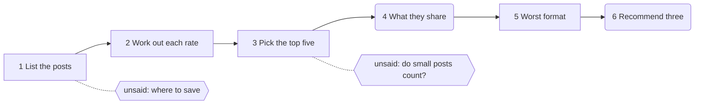

# Worked example (calibration only, never data about the person's skill)

## The skill under test

```
Work through these steps in order.
Save each step's result into an `out` folder in the working directory
before moving on to the next step.
1. Read the posts file and list the posts with their numbers.
2. Work out the engagement rate for each post.
3. Pick the top five posts.
4. Say what the top posts have in common.
5. Pick the worst format.
6. Recommend the next three posts to make. Keep it short.
```

Input: a spreadsheet of 30 invented posts (format, topic, reach, likes, comments, saves, shares).
Planted answers: four of the true top five are meal prep carousels; two posts went viral with a poor rate; one small post has a high rate and belongs in the top five.

## The map

| Step | Kind | Left unsaid |
|---|---|---|
| 1 List | deterministic, could be code | Where the file is saved ("the working directory" can mean more than one folder). |
| 2 Rates | deterministic, could be code | Which formula (every run chose the same, so it never changed a result). |
| 3 Top five | deterministic once the rule is written | Whether a post that reached very few people counts. |
| 4 In common | probabilistic | nothing that changed a result |
| 5 Worst format | deterministic, could be code | How "worst" is measured (never changed a result). |
| 6 Recommend | probabilistic | nothing that changed a result |



## The checks

| Step | Check | Kind |
|---|---|---|
| 1 | All 30 posts are listed. | exact |
| 2 | The rate for three named posts is right to one decimal place. | exact |
| 3 | The five picked are the five right posts; neither viral post is among them. | exact |
| 4 | It names carousel and it names meal prep. | exact |
| 5 | It names photo. | exact |
| 6 | It recommends a meal prep carousel. | exact |

One check passed a wrong answer: a run listed the small post in a raw ranking, then left it out of its final five, and the check found the name anywhere in the file.

## The counts, before

- Haiku 4.5: finished 2 of 5; its first save was refused every run; twice it stopped following the steps and answered in chat with the viral posts first.
- Sonnet 5.5: finished 5 of 5; step 3 gave two different top fives from the same data (small post dropped in 3 runs, kept in 2).
- Opus 5.5: finished 5 of 5 with the same top five every time, small post dropped in all five ("P15 is excluded: … only had 430 reach … that rate is mostly noise").
- Every run on every model ended in a tidy, confident review.

## The fix: two sentences

Step 1, before: `Save each step's result into an `out` folder in the working directory.`
After: `Save each step's result into an `out` folder inside the folder you were started in (your current working directory), never beside the data files.`

Step 3, before: `3. Pick the top five posts.`
After: `3. Pick the top five posts by engagement rate. Every post counts, however small its reach; if you think a post is too small to trust, keep it in the five and say so in a note.`

## The counts, after (runs out of five)

| | Haiku 4.5 | Sonnet 5.5 | Opus 5.5 |
|---|---|---|---|
| Finished all six steps | 2 → 4 | 5 → 5 | 5 → 5 |
| The right top five | 2 → 4 | 2 → 5 | 0 → 5 |

## What it taught

- The final answer hid everything; the differences were in the steps.
- Both faults sat where the skill said nothing, and the map flagged both before anything ran.
- The model changes the behaviour: the strongest gave the same answer every time, and it was not the one wanted.
- A check can be wrong: break the step on purpose before trusting its check.
- Wording has a limit: Haiku still saved to the wrong place in one run in five, taking the skill's own folder (which Claude Code names at skill start) as the place to save. Steps 1, 2, 3 and 5 are jobs for code; the model keeps 4 and 6.
